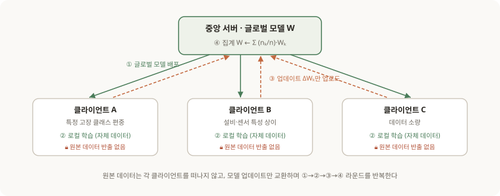
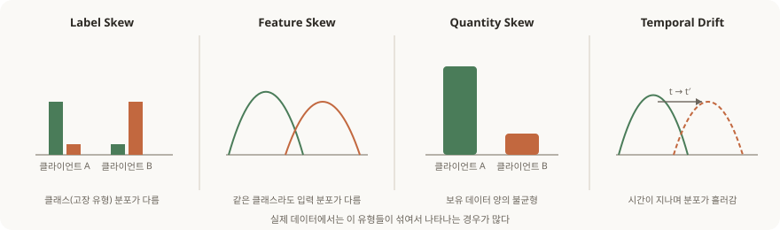
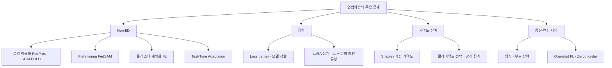

# 연합학습 개요 — FedAvg와 Non-IID 문제

> **연합학습(Federated Learning, FL)**: 데이터를 한곳에 모으지 않고, 각 참여자(클라이언트)가 자기 데이터로 로컬 학습한 뒤 **모델 업데이트만 교환**해 공동의 글로벌 모델을 만드는 분산 학습 패러다임 (McMahan et al., 2017, FedAvg)

데이터를 밖으로 내보내기 어려운 곳(병원, 모바일 기기, 여러 회사·공장 등)에서 "데이터 대신 모델을 이동시켜" 함께 학습하는 방법이다. 이 폴더는 공개 논문 기반으로 FL의 대표 문제와 기법을 정리한 스터디 노트다.

---

## 1. 기본 동작 — FedAvg

한 라운드(round)는 네 단계로 돈다.

1. **배포**: 서버가 글로벌 모델 $W^t$ 를 참여 클라이언트에 전송
2. **로컬 학습**: 각 클라이언트 $k$ 가 자기 데이터로 $E$ 에폭 학습 → $W_k^{t+1}$
3. **업로드**: 업데이트(모델 또는 차분 $\Delta W_k$)만 서버로 전송 — **원본 데이터는 반출되지 않음**
4. **집계**: 데이터 양 비례 가중 평균

$$W^{t+1} = \sum_{k=1}^{K} \frac{n_k}{n} W_k^{t+1}$$

이 단순한 선형 평균이 잘 동작하는 전제는 **클라이언트들의 데이터가 IID(독립동일분포)** 라는 것. 현실에서는 이 전제가 자주 깨진다.

---

## 2. Non-IID — 왜 어려운가

Kairouz et al.(2021, *Advances and Open Problems in FL*)의 분류를 따르면 대표 유형은 다음과 같다. 예시는 설비 진단 데이터로 들었다.

| 유형 | 의미 | 예시 |
|------|------|-----------|
| **Label skew** | 클래스 분포가 클라이언트마다 다름 | 한 사이트는 베어링 결함 위주, 다른 사이트는 언밸런스 위주 |
| **Feature skew** | 같은 클래스라도 입력 분포가 다름 | 설비 기종·센서 사양·운전 조건 차이 |
| **Quantity skew** | 보유 데이터 양의 불균형 | 오래 운영한 사이트 vs 새로 시작한 사이트 |
| **Temporal drift** | 시간에 따라 분포가 변함 | 설비 노후화, 계절·부하 변동 |

실제 데이터에서는 이 유형들이 섞여서 나타나는 경우가 많다. Non-IID에서 FedAvg는 수렴이 느려지거나 정확도가 떨어진다 (Zhao et al., 2018; Li et al., 2020).

---

## 3. 이 폴더의 구성

| 주제 | 핵심 질문 | 노트 |
|----|-----------|------|
| **Non-IID 대응** | 클라이언트 간 분포 차이를 어떻게 줄이거나 흡수하나? | [[01_non-iid-methods]] |
| **집계** | 단순 평균의 한계는 무엇이고, LLM·LoRA는 어떻게 합치나? | [[02_fl-aggregation]] |
| **기여도·선택** | 클라이언트 기여를 어떻게 재고, 누구를 참여시키나? | [[03_client-contribution]] |
| **통신·엣지 효율** | 통신량과 엣지 연산을 어떻게 줄이나? | [[04_edge-adaptation]] |

---

## 면접 예상 질문

- 연합학습과 일반 분산 학습(data parallelism)의 차이는? → 데이터가 이동하지 않고, 클라이언트 데이터가 Non-IID이며, 참여가 불안정하다는 점
- FedAvg가 Non-IID에서 성능이 떨어지는 근본 원인은? → 로컬 최적점들이 서로 멀어져 가중 평균이 어느 로컬 분포에도 맞지 않는 지점에 놓임 ([[02_fl-aggregation]]의 loss barrier 참고)
- 프라이버시 외에 FL의 실무적 제약은? → 통신량, 엣지 장비 연산 한계, 라벨 부재, 데이터 drift ([[04_edge-adaptation]], [[01_non-iid-methods]])

## 참고문헌

- McMahan et al., *Communication-Efficient Learning of Deep Networks from Decentralized Data*, AISTATS 2017
- Kairouz et al., *Advances and Open Problems in Federated Learning*, FnTML 2021
- Zhao et al., *Federated Learning with Non-IID Data*, arXiv 2018
- Li et al., *On the Convergence of FedAvg on Non-IID Data*, ICLR 2020
