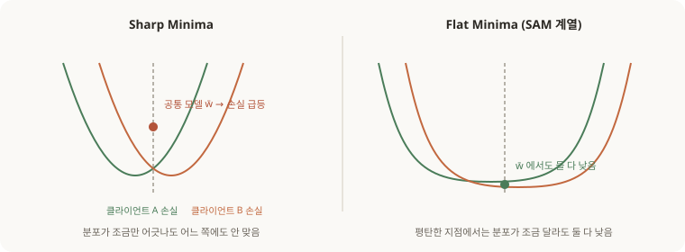
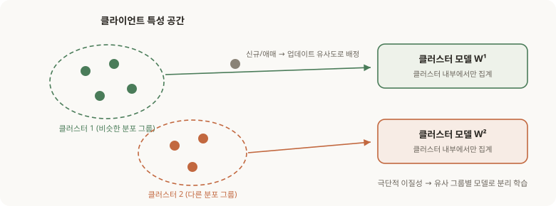

# Non-IID 대응 기법 정리

> 공개 논문에 나오는 Non-IID 대응 기법을 계열별로 정리한다. 실제로는 한 가지만 쓰기보다 문제 상황에 맞게 조합한다.

| 계열 | 발상 | 대표 기법 |
|------|------|-----------|
| 로컬 정규화·보정 | 로컬 학습이 글로벌에서 너무 멀어지지 않게 | FedProx, SCAFFOLD |
| Flat minima | 분포가 조금 달라도 손실이 덜 변하는 지점 찾기 | FedSAM, FedSAM 계열 |
| 클러스터 FL | 비슷한 클라이언트끼리 따로 학습 | CFL, IFCA |
| 개인화 FL | 공통 부분 + 클라이언트별 부분으로 분리 | FedPer, Ditto, pFedMe |
| Test-Time Adaptation | 배포 후 라벨 없는 입력으로 적응 | TENT, FedTHE |

---

## 1. 로컬 정규화·보정

- **FedProx** (Li et al., 2020): 로컬 목적함수에 근접 항 $\frac{\mu}{2}\|W - W^t\|^2$ 을 더해 글로벌 모델에서 멀리 벗어나지 않게 한다
- **SCAFFOLD** (Karimireddy et al., 2020): 서버·클라이언트가 제어 변량(control variate)을 유지해 로컬 그래디언트 방향의 편향을 보정한다
- 자세한 드리프트 설명은 [[02_fl-aggregation]] §3

## 2. Flat minima — SAM 계열

손실 지형(loss landscape)에서 **뾰족한(sharp) 최적점**보다 **평탄한(flat) 최적점**이 입력 분포 변화에 덜 민감하다는 관찰에서 출발한다.

- **SAM** (Foret et al., 2021): 파라미터 근방의 최악 방향 손실까지 낮추는 min-max 최적화

$$\min_W \max_{\|\epsilon\| \le \rho} L(W + \epsilon)$$

- **FL 적용** (Caldarola et al., 2022; Qu et al., 2022): 로컬 학습에 SAM을 쓰면 로컬 모델들이 평탄한 영역에 모여, 평균했을 때의 성능 저하가 줄어든다고 보고됨

## 3. 클러스터 FL

클라이언트 간 차이가 너무 크면 글로벌 모델 하나 대신 **비슷한 클라이언트끼리 묶어 클러스터별 모델**을 학습한다.

- **CFL** (Sattler et al., 2020): 업데이트 벡터의 코사인 유사도로 클라이언트를 재귀적으로 분할
- **IFCA** (Ghosh et al., 2020): 클러스터 모델 여러 개를 두고, 각 클라이언트가 자기 데이터에서 손실이 가장 낮은 클러스터를 골라 참여
- 고려할 점: 클러스터 수를 미리 알기 어렵다, 클러스터 간 지식 공유가 끊긴다

## 4. 개인화 FL

글로벌 모델 하나로 모두를 만족시키기 어려울 때, 공통 표현은 함께 학습하고 일부는 클라이언트별로 둔다.

- **FedPer** (Arivazhagan et al., 2019): 하위 층은 공유, 마지막 층(head)은 클라이언트별
- **Ditto** (Li et al., 2021): 글로벌 모델과 개인 모델을 함께 학습하고 둘 사이 거리를 정규화
- **pFedMe** (T Dinh et al., 2020): Moreau envelope 기반 개인화

## 5. Test-Time Adaptation (TTA)

배포 후 만나는 데이터 분포가 학습 때와 다를 때, **라벨 없이 추론 시점 입력만으로** 모델을 조금 조정하는 기법이다.

- **TENT** (Wang et al., 2021): 예측 엔트로피를 최소화하도록 BatchNorm의 affine 파라미터만 갱신
- BN 통계 재추정, 의사 라벨(pseudo-label) 자기학습도 흔한 방법
- **FL과 결합한 연구**: 개인화 FL 모델을 테스트 시점 분포 변화에 강건하게 만드는 FedTHE (Jiang & Lin, 2023) 등
- 주의: 엔트로피 최소화가 틀린 예측의 확신만 키우는 붕괴(collapse) 위험이 있어, 적응 범위 제한이나 주기적 리셋 같은 안정화 장치가 필요

---

## 면접 예상 질문

- FedProx와 SCAFFOLD의 차이는? → FedProx는 근접 항으로 이탈을 억제, SCAFFOLD는 제어 변량으로 그래디언트 방향 편향 자체를 보정
- flat minima가 FL의 Non-IID에 유리한 이유는? → 파라미터·분포가 조금 달라져도 손실이 크게 변하지 않아, 평균 모델이 각 클라이언트에서 덜 나빠짐
- 원본 데이터 없이 클라이언트를 클러스터링하는 방법은? → 업데이트 벡터 유사도(CFL), 클러스터 모델별 손실로 자기 배정(IFCA)
- TTA의 대표적 실패 모드는? → 엔트로피 최소화로 인한 오적응·붕괴

## 참고문헌

- Li et al., *Federated Optimization in Heterogeneous Networks (FedProx)*, MLSys 2020
- Karimireddy et al., *SCAFFOLD*, ICML 2020
- Foret et al., *Sharpness-Aware Minimization*, ICLR 2021
- Caldarola et al., *Improving Generalization in Federated Learning by Seeking Flat Minima*, ECCV 2022
- Qu et al., *Generalized Federated Learning via Sharpness Aware Minimization*, ICML 2022
- Sattler et al., *Clustered Federated Learning*, IEEE TNNLS 2020
- Ghosh et al., *An Efficient Framework for Clustered Federated Learning (IFCA)*, NeurIPS 2020
- Arivazhagan et al., *Federated Learning with Personalization Layers*, arXiv 2019
- Li et al., *Ditto: Fair and Robust Federated Learning Through Personalization*, ICML 2021
- T Dinh et al., *Personalized Federated Learning with Moreau Envelopes*, NeurIPS 2020
- Wang et al., *Tent: Fully Test-Time Adaptation by Entropy Minimization*, ICLR 2021
- Jiang & Lin, *Test-Time Robust Personalization for Federated Learning*, ICLR 2023
