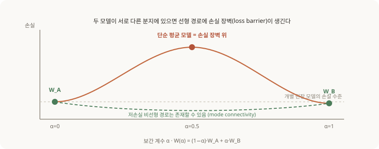
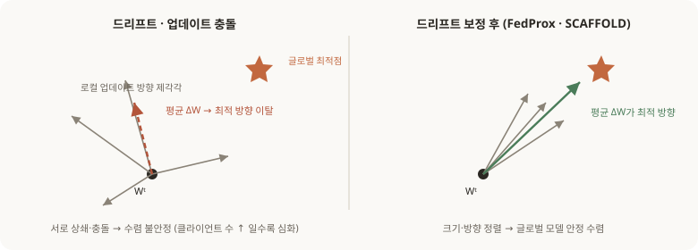

# 연합학습 집계 기법

> "로컬 모델들을 어떻게 합칠 것인가" — 단순 평균이 실패하는 조건, LLM·LoRA를 연합 학습할 때의 집계 문제, 클라이언트 드리프트 보정을 공개 논문 기준으로 정리한다.

## 1. 단순 평균이 손해가 되는 조건 — Loss barrier

두 모델이 손실 지형의 **서로 다른 분지(basin)** 에 있으면, 두 모델을 잇는 선형 경로 위에서 손실이 솟는 **loss barrier** 가 생긴다. 이때 평균 모델은 장벽 위, 즉 **각 모델보다 오히려 나쁜** 지점에 놓인다.

- **Linear mode connectivity** (Frankle et al., 2020): 같은 분지 안의 모델들은 선형 보간해도 손실이 낮게 유지된다
- **뉴런 순서(permutation) 문제** (Entezari et al., 2022): 신경망은 뉴런 순서를 바꿔도 같은 함수라서, 순서를 맞추지 않고 평균하면 장벽이 생기기 쉽다
- **대응**: 뉴런을 정렬한 뒤 합치기 — FedMA (Wang et al., 2020), Git Re-Basin (Ainsworth et al., 2023). FedAvg처럼 **같은 초기값에서 출발하고 로컬 학습을 짧게** 하는 것도 같은 분지에 머물게 하는 효과가 있다

## 2. LLM 연합 파인튜닝과 LoRA 집계

LLM 전체를 주고받는 것은 통신·연산 모두 비현실적이라, **LoRA 같은 PEFT 어댑터만 학습·교환**하는 방식이 일반적이다 (FedIT, Zhang et al., 2024; OpenFedLLM, Ye et al., 2024).

> **LoRA 복습** (Hu et al., 2021): 가중치 갱신을 $\Delta W = BA$ ($B \in \mathbb{R}^{d \times r}, A \in \mathbb{R}^{r \times k}, r \ll d$)로 제한해 학습 파라미터를 크게 줄이는 PEFT 기법.

### LoRA를 그냥 평균하면 생기는 오차

$$\underbrace{\tfrac{1}{K}\sum_k B_k A_k}_{\text{갱신의 평균}} \;\ne\; \underbrace{\Big(\tfrac{1}{K}\sum_k B_k\Big)\Big(\tfrac{1}{K}\sum_k A_k\Big)}_{\text{요소별 평균 후 곱}}$$

곱의 평균과 평균의 곱이 다르기 때문에, $A$·$B$를 따로 평균하면 의도한 갱신과 다른 값이 적용된다.

공개된 해법 예시:
- **FFA-LoRA** (Sun et al., 2024): $A$를 고정하고 $B$만 학습·평균 → 곱이 선형이 되어 오차가 사라짐
- **FLoRA** (Wang et al., 2024): 클라이언트 어댑터를 쌓아(stacking) 합쳐 정확한 집계, 서로 다른 랭크도 지원
- 갱신 $\Delta W_k$ 를 직접 합친 뒤 SVD로 다시 저랭크로 줄이는 방식도 쓰인다

### 구조가 다른 모델끼리 합치기

모델 구조가 다르면 파라미터 평균 자체가 불가능하다. 이때는 공용(또는 합성) 데이터에서 각 모델의 출력(로짓)을 모아 **지식 증류**로 합친다 — FedDF (Lin et al., 2020).

## 3. 클라이언트 드리프트

로컬 학습을 오래 할수록 각 클라이언트가 자기 데이터의 최적점 쪽으로 끌려가, 업데이트가 글로벌 최적 방향에서 벗어나는 현상. Non-IID가 클수록, 로컬 스텝이 많을수록 심해진다.

- **FedProx** (Li et al., 2020): 근접 항으로 로컬 이탈 억제
- **SCAFFOLD** (Karimireddy et al., 2020): 제어 변량으로 그래디언트 방향 보정
- **FedNova** (Wang et al., 2020): 클라이언트마다 로컬 스텝 수가 다를 때 생기는 목적함수 불일치를 정규화해 보정
- 서버 쪽 최적화: 평균 업데이트를 "의사 그래디언트"로 보고 서버에서 Adam 등을 적용하는 FedOpt (Reddi et al., 2021)

---

## 면접 예상 질문

- Non-IID에서 평균 모델이 개별 모델보다 나빠질 수 있는 이유는? → 로컬 모델들이 서로 다른 분지에 있어 선형 경로에 loss barrier가 생기기 때문
- LoRA 어댑터를 A, B 따로 평균하면 왜 문제인가? → 곱의 평균 ≠ 평균의 곱. 해법 예: A 고정(FFA-LoRA), 어댑터 쌓기(FLoRA)
- 클라이언트 드리프트의 원인과 완화책은? → 원인: Non-IID + 긴 로컬 학습. 완화: FedProx, SCAFFOLD, FedNova

## 참고문헌

- Frankle et al., *Linear Mode Connectivity and the Lottery Ticket Hypothesis*, ICML 2020
- Entezari et al., *The Role of Permutation Invariance in Linear Mode Connectivity of Neural Networks*, ICLR 2022
- Wang et al., *Federated Learning with Matched Averaging (FedMA)*, ICLR 2020
- Ainsworth et al., *Git Re-Basin*, ICLR 2023
- Hu et al., *LoRA: Low-Rank Adaptation of Large Language Models*, arXiv 2021
- Zhang et al., *Towards Building the FederatedGPT: Federated Instruction Tuning*, ICASSP 2024
- Ye et al., *OpenFedLLM*, KDD 2024
- Sun et al., *Improving LoRA in Privacy-Preserving Federated Learning (FFA-LoRA)*, ICLR 2024
- Wang et al., *FLoRA: Federated Fine-Tuning Large Language Models with Heterogeneous Low-Rank Adaptations*, NeurIPS 2024
- Lin et al., *Ensemble Distillation for Robust Model Fusion in Federated Learning (FedDF)*, NeurIPS 2020
- Wang et al., *Tackling the Objective Inconsistency Problem in Heterogeneous Federated Optimization (FedNova)*, NeurIPS 2020
- Reddi et al., *Adaptive Federated Optimization*, ICLR 2021
