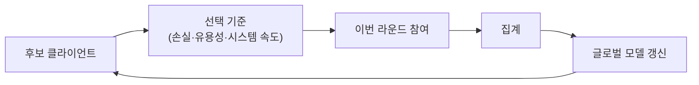

# 클라이언트 기여도 평가와 클라이언트 선택

> "누가 글로벌 모델을 실제로 좋게 만들었는가"를 재는 방법과, 매 라운드 누구를 참여시킬지 고르는 방법을 공개 논문 기준으로 정리한다.

## 왜 필요한가

- 클라이언트마다 데이터 양·품질이 달라 글로벌 모델에 대한 기여가 제각각이다
- 데이터 양 비례 가중($n_k/n$)은 "양 = 품질"이라고 가정한다. 대량·저품질 데이터를 가진 클라이언트가 모델을 좌우할 수 있다
- 참여 클라이언트가 많으면 매 라운드 일부만 골라야 하는데, 무작위 선택은 수렴이 느릴 수 있다

## 1. 기여도 측정

| 방법 | 아이디어 | 비용 |
|------|----------|------|
| Leave-one-out | 해당 클라이언트를 빼고 집계했을 때 성능이 얼마나 떨어지나 | 클라이언트 수만큼 재집계 |
| Shapley value | 모든 조합에 합류했을 때의 평균 성능 향상 | 정확 계산은 $2^K$ 조합 → 근사 필수 |
| 업데이트 유사도 | 다른 업데이트·글로벌 방향과의 코사인 유사도 | 저렴, 대신 간접 지표 |

$$\phi_k = \mathbb{E}_{S \subseteq K \setminus \{k\}} \big[ v(S \cup \{k\}) - v(S) \big]$$

- **Data Shapley** (Ghorbani & Zou, 2019)를 FL에 적용한 연구: Wang et al.(2019), 계산 비용을 줄인 **GTG-Shapley** (Liu et al., 2022)
- 유의점: 성능 $v(\cdot)$ 를 재려면 서버에 검증 셋이 필요하다. 업데이트가 남들과 다르다고 나쁜 것은 아니다(새로운 정보일 수도, 노이즈일 수도) → 성능 변화와 함께 봐야 한다

## 2. 클라이언트 선택

- **Power-of-Choice** (Cho et al., 2022): 후보 몇 개를 뽑아 그중 로컬 손실이 큰 클라이언트를 우선 선택 → 수렴 가속
- **Oort** (Lai et al., 2021): 통계적 유용성(손실)과 시스템 속도(느린 장비)를 함께 고려해 선택
- 공정성 주의: 특정 클라이언트를 계속 빼면 그 데이터 분포가 글로벌 모델에서 소외된다

## 3. 강건 집계 — 나쁜 업데이트의 영향 줄이기

기여도 측정과 같은 맥락에서, 이상하거나 악의적인 업데이트를 걸러내는 집계 규칙도 있다.

- **Krum** (Blanchard et al., 2017): 다른 업데이트들과 가장 가까운 업데이트를 선택
- **Trimmed mean / Median** (Yin et al., 2018): 좌표별로 극단값을 잘라내고 평균하거나 중앙값을 사용

---

## 면접 예상 질문

- 데이터 양 비례 가중($n_k/n$)의 문제점은? → 양 ≠ 품질. 대량·저품질 클라이언트가 글로벌 모델을 지배할 수 있음
- Shapley value를 FL 기여도에 그대로 쓰기 어려운 이유는? → 조합 수가 지수적이고 조합마다 재집계·평가 비용이 듦 → 근사 필수
- 클라이언트 선택에서 손실이 큰 클라이언트를 우선하면 생기는 장단점은? → 수렴은 빨라지지만, 이상치·노이즈 클라이언트가 과대 반영될 수 있음

## 참고문헌

- Ghorbani & Zou, *Data Shapley: Equitable Valuation of Data for Machine Learning*, ICML 2019
- Wang et al., *Measure Contribution of Participants in Federated Learning*, IEEE Big Data 2019
- Liu et al., *GTG-Shapley: Efficient and Accurate Participant Contribution Evaluation in Federated Learning*, ACM TIST 2022
- Cho et al., *Towards Understanding Biased Client Selection in Federated Learning*, AISTATS 2022
- Lai et al., *Oort: Efficient Federated Learning via Guided Participant Selection*, OSDI 2021
- Blanchard et al., *Machine Learning with Adversaries: Byzantine Tolerant Gradient Descent (Krum)*, NeurIPS 2017
- Yin et al., *Byzantine-Robust Distributed Learning: Towards Optimal Statistical Rates*, ICML 2018
