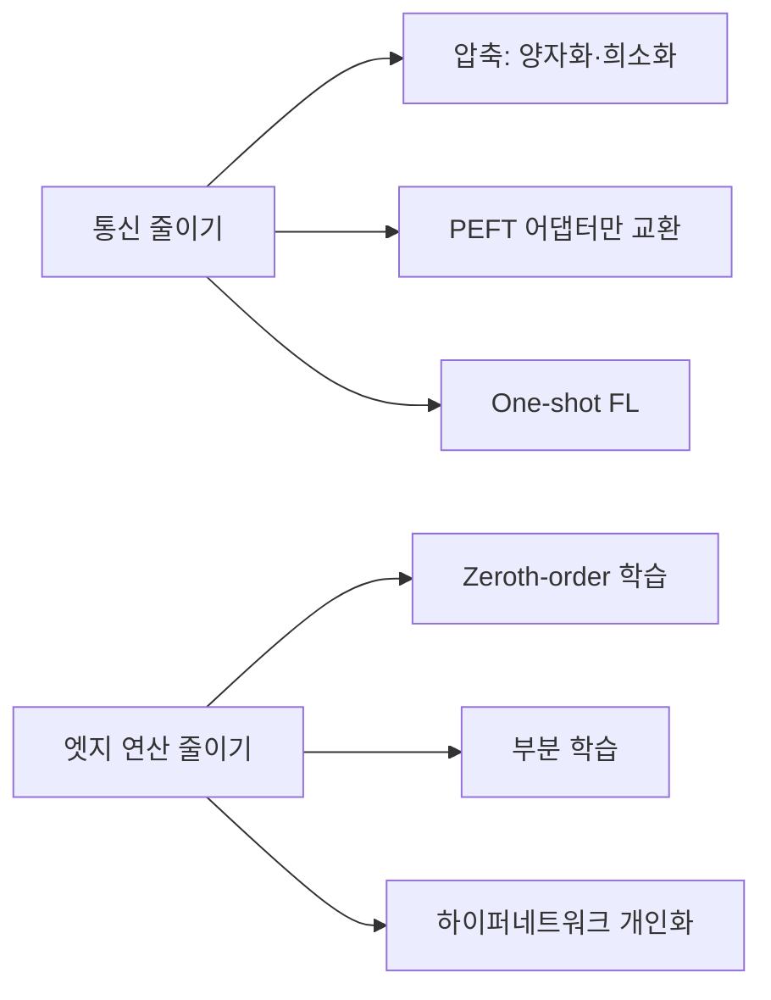

# 통신·엣지 효율화

> FL은 라운드마다 모델을 주고받기 때문에 **통신**이 병목이 되기 쉽고, 엣지 장비는 **연산·메모리**가 부족하다. 이를 줄이는 공개된 기법들을 정리한다.

## 왜 필요한가

| 제약 | 설명 |
|------|------|
| 통신 대역폭 | 모델 크기 × 클라이언트 수 × 라운드 수만큼 전송 |
| 느린·불안정한 참여 | 일부 클라이언트가 늦거나 끊기면 라운드가 지연 |
| 엣지 연산 | 역전파는 순전파보다 메모리·연산이 훨씬 많이 듦 |

## 1. 통신량 줄이기

- **라운드 수 줄이기**: 로컬 스텝을 늘려 라운드당 진척을 키움 (FedAvg 자체의 발상) — 대신 드리프트 증가 ([[02_fl-aggregation]] §3)
- **업데이트 압축** (Konečný et al., 2016):
  - 양자화 — QSGD (Alistarh et al., 2017)
  - 희소화 — 큰 값만 보내는 Top-k, Deep Gradient Compression (Lin et al., 2018)
  - 스케치 — FetchSGD (Rothchild et al., 2020)
- **작은 것만 주고받기**: LoRA 같은 PEFT 어댑터만 교환 ([[02_fl-aggregation]] §2)
- **부분 참여**: 매 라운드 일부 클라이언트만 참여 ([[03_client-contribution]] §2)

## 2. One-shot FL — 라운드를 한 번으로

- **One-shot FL** (Guha et al., 2019): 각 클라이언트가 로컬 모델을 한 번만 보내고, 서버가 앙상블·증류로 하나의 모델을 만든다
- 통신은 최소지만, Non-IID가 심하면 성능 손실이 커질 수 있다
- 지식 증류 기반 합치기는 FedDF (Lin et al., 2020) 참고

## 3. 엣지 연산 줄이기

- **Zeroth-order(순전파 기반) 최적화**: 그래디언트를 역전파 대신 순전파 두 번의 손실 차이로 추정 — **MeZO** (Malladi et al., 2023)는 추론 수준 메모리로 LLM 파인튜닝이 가능함을 보였다. FL에 적용한 연구로 FedZO (Fang et al., 2022)
- **부분 학습**: 일부 층·어댑터만 학습해 메모리 절약
- **하이퍼네트워크 기반 개인화**: 서버의 하이퍼네트워크가 클라이언트 임베딩을 받아 개인화 모델 가중치를 생성 — pFedHN (Shamsian et al., 2021). 클라이언트는 작은 모델만 다루면 된다

---

## 면접 예상 질문

- FL에서 통신량을 줄이는 대표 방법 세 가지는? → 로컬 스텝 늘리기(라운드 감소), 업데이트 압축(양자화·희소화), 작은 파라미터만 교환(PEFT)
- 업데이트를 희소화할 때 정확도 손실을 줄이는 방법은? → 보내지 않은 값을 누적해 다음 라운드에 더하는 오차 누적(error feedback)
- Zeroth-order 최적화의 장단점은? → 역전파가 필요 없어 메모리가 적지만, 그래디언트 추정 분산이 커서 수렴이 느림

## 참고문헌

- Konečný et al., *Federated Learning: Strategies for Improving Communication Efficiency*, arXiv 2016
- Alistarh et al., *QSGD: Communication-Efficient SGD via Gradient Quantization and Encoding*, NeurIPS 2017
- Lin et al., *Deep Gradient Compression*, ICLR 2018
- Rothchild et al., *FetchSGD: Communication-Efficient Federated Learning with Sketching*, ICML 2020
- Guha et al., *One-Shot Federated Learning*, arXiv 2019
- Lin et al., *Ensemble Distillation for Robust Model Fusion in Federated Learning (FedDF)*, NeurIPS 2020
- Malladi et al., *Fine-Tuning Language Models with Just Forward Passes (MeZO)*, NeurIPS 2023
- Fang et al., *Communication-Efficient Stochastic Zeroth-Order Optimization for Federated Learning (FedZO)*, IEEE TSP 2022
- Shamsian et al., *Personalized Federated Learning using Hypernetworks (pFedHN)*, ICML 2021
