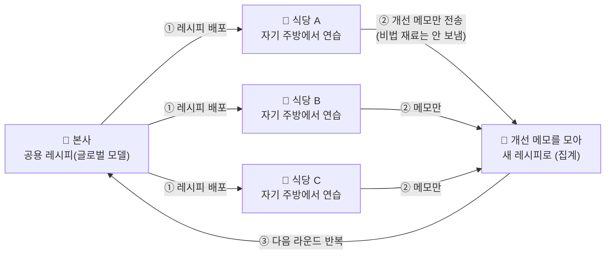
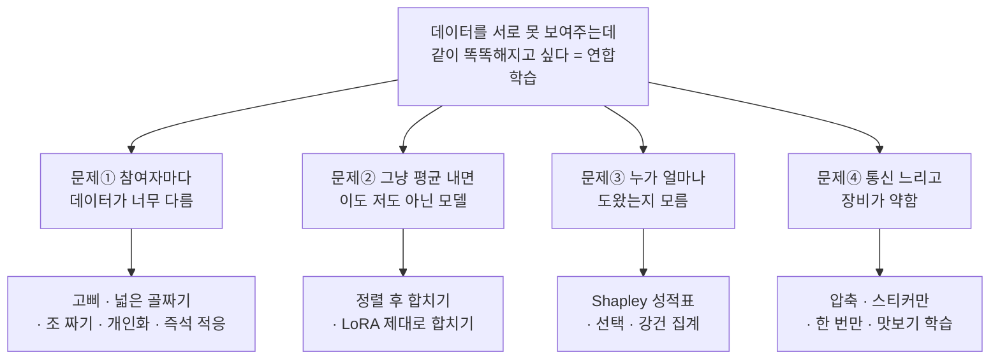

# 연합학습 ELI5 — 레시피 비유로 아주 쉽게

> 이 폴더 전체([[00_fl-overview]] ~ [[04_edge-adaptation]])를 비유 하나로 꿰어 설명하는 쉬운 버전. 정확한 정의·수식은 각 본 노트 참고.

## 0. 연합학습이 뭐야?

전국에 체인 식당이 있다. 각 식당에는 **절대 밖으로 못 내보내는 비법 재료(= 데이터)** 가 있다. 그런데 다 같이 요리 실력(= 모델 성능)은 키우고 싶다.

그래서 이렇게 한다:

1. 본사가 **공용 레시피(글로벌 모델)** 를 모든 식당에 나눠준다
2. 각 식당은 **자기 주방에서만** 레시피로 연습한다 (로컬 학습)
3. 본사에는 **"여기를 이렇게 고치면 좋겠어요" 메모만** 보낸다 — 재료(데이터)는 절대 안 보냄
4. 본사가 메모들을 합쳐 레시피를 개선하고, 다시 1번부터 반복

여기까지가 기본형(FedAvg, [[00_fl-overview]]). 문제는 — **현실의 식당들은 서로 너무 다르다**는 것.

## 1. 문제① 식당마다 손님이 너무 다르다 → [[01_non-iid-methods]]

매운맛 동네 식당과 싱거운 동네 식당의 개선 메모를 반반 섞으면? **아무 동네에서도 안 팔리는 어중간한 맛**이 된다. 이게 **Non-IID 문제**.

알려진 해법들:

- **고삐 매기 (FedProx·SCAFFOLD)**: 각 식당이 레시피를 자기 입맛대로 너무 멀리 바꾸지 못하게 고삐를 맨다
- **넓은 골짜기 찾기 (flat minima, SAM)**: 공이 **뾰족한 골짜기**에 있으면 살짝만 흔들어도 튀어나가지만, **넓은 골짜기**에 있으면 흔들려도 그 안에 있다. 조금씩 다른 식당들이 다 같이 만족하는 레시피를 찾는다
- **비슷한 반끼리 조 짜기 (클러스터 FL)**: 매운맛 지점끼리·싱거운 지점끼리 **조별 레시피**를 만든다
- **기본 + 우리 집 소스 (개인화 FL)**: 기본 레시피는 같이 쓰고, 마지막 소스만 식당별로 따로 만든다
- **즉석 간 보기 (Test-Time Adaptation)**: 오늘 온 손님 반응만 보고 **그 자리에서 간을 조금씩 조절**한다

## 2. 문제② 그냥 평균 내면 손해 본다 → [[02_fl-aggregation]]

- **산봉우리 함정 (loss barrier)**: 산 아래 마을 A와 마을 B의 중간 지점은 **산꼭대기**일 수 있다. 좋은 레시피 둘의 "정확히 중간"이 좋으리란 법이 없다
- **곱셈 숙제의 함정 (LoRA 집계)**: 레시피북 전체 대신 **얇은 수정 스티커(어댑터 = B×A)** 만 주고받는데, B끼리·A끼리 따로 평균 내면 틀린다. **(2×3)과 (4×5)의 평균은 13**이지, **(2와 4의 평균)×(3과 5의 평균) = 12**가 아니다
- **줄다리기 (클라이언트 드리프트)**: 각 식당이 메모를 **자기 동네 취향 쪽으로만** 세게 당기면, 가운데(글로벌 모델)가 엉뚱한 데로 끌려간다

## 3. 문제③ 누가 도움이 됐을까 → [[03_client-contribution]]

- **성적표 (Shapley value)**: 이 식당 메모를 빼고 합쳐보면 레시피가 나빠지나? 여러 조합으로 따져서 공정하게 점수를 매긴다
- **이번 회의엔 누구를 부를까 (클라이언트 선택)**: 아직 레시피가 잘 안 맞는 식당을 먼저 부르면 빨리 좋아진다
- **이상한 메모 걸러내기 (강건 집계)**: 혼자 엉뚱한 메모는 빼거나 중앙값을 쓴다

## 4. 문제④ 택배가 느리고 주방이 작다 → [[04_edge-adaptation]]

- **메모 줄여 쓰기 (압축)**: 중요한 부분만 짧게 적어 보낸다
- **스티커만 보내기 (PEFT)**: 레시피북 전체 대신 얇은 스티커만
- **한 번만 보내기 (One-shot FL)**: 각 식당이 메모를 딱 한 번만 보내고 본사가 알아서 합친다
- **맛보기만으로 개선 (Zeroth-order)**: 이것저것 조금 바꿔 맛만 비교해 보며 고친다 — 복잡한 계산(역전파)이 필요 없다

## 한눈에 — 문제 지도

| 비유 | 진짜 용어 | 본 노트 |
|------|-----------|---------|
| 비법 재료는 안 보내고 메모만 | 연합학습, FedAvg | [[00_fl-overview]] |
| 동네마다 입맛이 다름 | Non-IID (label/feature/quantity skew, drift) | [[00_fl-overview]] |
| 고삐 매기 | FedProx, SCAFFOLD | [[01_non-iid-methods]] |
| 넓은 골짜기 | flat minima, SAM | [[01_non-iid-methods]] |
| 비슷한 반끼리 조 짜기 | 클러스터 FL (CFL, IFCA) | [[01_non-iid-methods]] |
| 기본 + 우리 집 소스 | 개인화 FL | [[01_non-iid-methods]] |
| 즉석 간 보기 | Test-Time Adaptation | [[01_non-iid-methods]] |
| 마을 중간이 산꼭대기 | loss barrier | [[02_fl-aggregation]] |
| 곱셈 숙제의 함정 | LoRA 집계 오차 | [[02_fl-aggregation]] |
| 줄다리기 | 클라이언트 드리프트 | [[02_fl-aggregation]] |
| 성적표 | Shapley 기반 기여도 | [[03_client-contribution]] |
| 메모 줄여 쓰기·한 번만 보내기 | 압축, One-shot FL | [[04_edge-adaptation]] |

> mermaid 소스는 `diagrams/fl-eli5-round.mmd`, `diagrams/fl-eli5-map.mmd`에 있음 (수정 시 소스가 기준).
