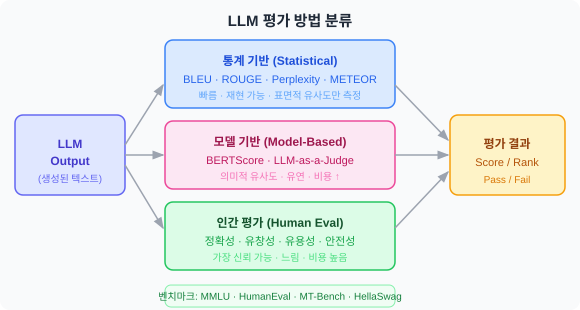
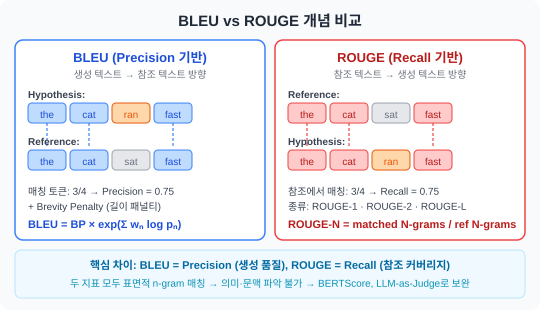

# LLM 평가 방법 (LLM Evaluation)

> 면접 필수 개념 위주 정리 — 통계 기반 / 모델 기반 / 벤치마크 / 할루시네이션

---

## 평가 방법 전체 지도



---

## 1. Perplexity (혼란도)

$$\text{Perplexity} = \exp\left(-\frac{1}{N} \sum_{i=1}^{N} \log P(w_i \mid w_1, \dots, w_{i-1})\right)$$

- 언어 모델이 텍스트를 얼마나 "잘 예측"하는지 측정
- **낮을수록 좋음** (모델이 덜 혼란스럽다)
- 단점: 서로 다른 토크나이저 사용 시 직접 비교 불가
- 활용: 언어 모델 사전학습 품질 평가, Fine-tuning 과적합 탐지

| Perplexity | 의미 |
|:----------:|------|
| 1 | 완벽한 예측 (다음 단어 100% 확신) |
| 10 | 평균 10개 선택지 중 1개 |
| 100+ | 모델이 텍스트를 거의 이해 못 함 |

---

## 2. BLEU / ROUGE



### BLEU (Bilingual Evaluation Understudy)

$$\text{BLEU} = BP \times \exp\left(\sum_{n=1}^{N} w_n \log p_n\right)$$

- **Precision 기반**: 생성 텍스트의 n-gram이 참조에 얼마나 포함되는지
- `BP` = Brevity Penalty: 생성 문장이 너무 짧으면 패널티
- 번역 품질 평가에서 출발, 요약·생성에도 사용
- 단점: 어순 무시, 동의어 인식 불가, 의미 파악 불가

### ROUGE (Recall-Oriented Understudy for Gisting Evaluation)

- **Recall 기반**: 참조 텍스트의 n-gram이 생성에 얼마나 포함되는지
- 주로 **요약(Summarization)** 평가에 사용

| 종류 | 설명 |
|------|------|
| **ROUGE-1** | 단어(unigram) 단위 겹침 |
| **ROUGE-2** | bigram 단위 겹침 |
| **ROUGE-L** | 최장 공통 부분 수열(LCS) 기반 |

### BLEU vs ROUGE 한눈에

| | BLEU | ROUGE |
|--|:----:|:-----:|
| 기준 방향 | 생성 → 참조 (Precision) | 참조 → 생성 (Recall) |
| 주 사용처 | 번역 | 요약 |
| 의미 파악 | ❌ | ❌ |
| 동의어 처리 | ❌ | ❌ |

> **면접 핵심**: BLEU/ROUGE 모두 표면적 n-gram 매칭 → 의미·맥락 파악 불가. BERTScore, LLM-as-Judge로 보완 필요.

---

## 3. BERTScore

$$\text{BERTScore} = F_1 \text{ 기반으로 Precision}_{\text{BERT}} \text{ 와 Recall}_{\text{BERT}} \text{ 계산}$$

- BERT 임베딩 공간에서 **코사인 유사도**로 의미적 매칭
- n-gram 대신 문맥 임베딩 사용 → **동의어, 패러프레이즈 인식 가능**
- BLEU/ROUGE보다 인간 판단과 상관관계 높음

```
Reference: "The cat is on the mat"
Hypothesis: "A feline rests upon the rug"

BLEU: ≈ 0 (겹치는 단어 없음)
BERTScore: ≈ 0.85 (의미적으로 유사)
```

---

## 4. LLM-as-a-Judge

GPT-4 등 강력한 LLM을 평가자로 사용해 생성 품질을 판단.

### 방식

```
평가 프롬프트:
"아래 두 답변 중 더 도움이 되는 것은? 이유와 함께 A 또는 B를 선택하라."

Response A: ...
Response B: ...
```

### 종류

| 방식 | 설명 |
|------|------|
| **Pointwise** | 단일 응답에 절대 점수 부여 (1~10) |
| **Pairwise** | 두 응답 비교, 더 좋은 것 선택 (A vs B) |
| **Reference-based** | 참조 답변과 비교해 평가 |

### 장단점

| 장점 | 단점 |
|------|------|
| 다양한 기준 동시 평가 가능 | Position Bias (앞에 나온 답 선호) |
| 인간 평가 대비 빠르고 저렴 | Verbosity Bias (길고 자세한 답 선호) |
| 유연한 기준 설정 | 자기 생성 선호 (Self-enhancement bias) |
| 의미·맥락 이해 | 재현성 낮음 (temperature > 0) |

> **바이어스 완화**: 순서 랜덤화 + 평가 여러 번 반복 + CoT 유도 프롬프트

---

## 5. 주요 벤치마크

| 벤치마크 | 평가 대상 | 형식 |
|----------|----------|------|
| **MMLU** | 57개 학문 분야 지식 (의학, 법, 수학 등) | 4지선다 |
| **HumanEval** | Python 코드 생성 정확도 | pass@k |
| **MT-Bench** | 다중 턴 대화 품질 | LLM-as-Judge |
| **HellaSwag** | 상식 추론 (다음 문장 예측) | 4지선다 |
| **TruthfulQA** | 사실 기반 정확성, 할루시네이션 | 진위 판단 |
| **GSM8K** | 초등 수준 수학 문제 풀이 | 단계별 추론 |
| **MATH** | 고등 수준 수학 경시 문제 | 정답 일치 |
| **ARC** | 초등~중학 과학 상식 | 4지선다 |

### pass@k (코드 생성 평가)

$$\text{pass@k} = 1 - \frac{\binom{n-c}{k}}{\binom{n}{k}}$$

- n번 생성 중 c개가 정답일 때, k개를 골랐을 때 하나 이상 정답 확률
- `pass@1`: 한 번에 맞출 확률, `pass@10`: 10번 중 하나라도 맞출 확률

---

## 6. 할루시네이션 평가 (Hallucination Evaluation)

LLM이 사실이 아닌 내용을 자신감 있게 생성하는 현상.

### 종류

| 종류 | 설명 | 예시 |
|------|------|------|
| **Intrinsic** | 소스 내 정보와 모순 | 요약 시 원문과 반대 내용 |
| **Extrinsic** | 소스에 없는 정보를 생성 | RAG에서 없는 사실 추가 |
| **Factual** | 실제 세계 사실과 다름 | 존재하지 않는 논문 인용 |

### 평가 방법

| 방법 | 설명 |
|------|------|
| **TruthfulQA** | 사람들이 자주 믿는 오해 기반 질문 |
| **FActScoring** | 생성 문장을 원자적 사실로 분해 후 개별 검증 |
| **SelfCheckGPT** | 같은 프롬프트 여러 번 샘플링 → 불일치 = 할루시네이션 |
| **NLI 기반** | 전제-가설 관계로 사실 일치 여부 판단 |
| **LLM-as-Judge** | 평가 LLM이 사실 정확성 판단 |

---

## 7. 인간 평가 기준 (Human Evaluation)

| 기준 | 설명 |
|------|------|
| **Fluency** | 문장이 자연스럽고 문법적으로 올바른가 |
| **Coherence** | 문맥이 일관성 있게 흐르는가 |
| **Relevance** | 질문/주제와 관련 있는 답변인가 |
| **Accuracy** | 사실적으로 정확한가 |
| **Helpfulness** | 사용자에게 실질적으로 도움이 되는가 |
| **Safety** | 유해하거나 편향된 내용이 없는가 |

평가 척도: Likert Scale (1~5점) 또는 Pairwise 비교

---

## 면접 자주 출제 Q&A

**Q. Perplexity가 낮으면 항상 좋은 모델인가?**  
→ 아님. 학습 데이터와 유사한 도메인에선 낮지만, 실제 유용성·사실성과는 무관. 다운스트림 태스크 성능으로 검증 필요.

**Q. BLEU가 높으면 좋은 번역인가?**  
→ 상관관계는 있지만 완전하지 않음. n-gram 기반이라 어순 유연성, 동의어, 자연스러움을 반영 못 함. 인간 평가와 함께 사용해야.

**Q. LLM-as-Judge의 가장 큰 문제는?**  
→ Position Bias (먼저 나온 답 선호), Verbosity Bias (긴 답 선호), Self-enhancement Bias (자사 모델 답 선호). 여러 번 반복 + 순서 랜덤화로 완화.

**Q. 벤치마크 점수가 높은 모델이 실제로도 좋은가?**  
→ 항상은 아님. Benchmark Contamination (학습 데이터에 테스트셋 포함), Overfitting to Benchmark 문제 있음. 실제 사용 케이스 기반 평가 병행 필요.

**Q. 할루시네이션을 줄이는 방법은?**  
→ RAG(외부 지식 주입), Fine-tuning, RLHF/DPO, 체인오브씽킹 프롬프트, Calibration(자신감 조정). 근본 해결보다는 완화 전략이 현실적.
