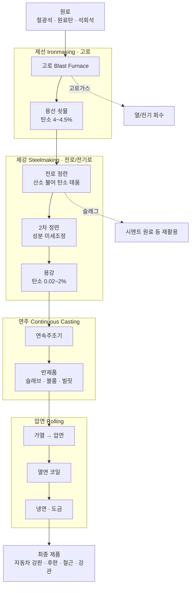

# 철강 일관제철 전체 흐름

> "돌(철광석)에서 철판까지." 철을 만드는 전 과정을 한 곳에서 처리하는 것이 **일관제철소**다.
> 이 문서는 각 단계를 잇는 **지도**다. 세부는 각 단계 문서로 이어진다.

---

## 핵심 개념

### 1. 철이란 무엇인가 — 문제는 "산소"

자연의 철은 대부분 **철광석 = 산화철(Fe₂O₃)**, 즉 철에 산소가 붙은 녹슨 상태로 존재한다.
그래서 제철의 본질은 딱 한 문장이다:

> **철광석에서 산소를 떼어내(환원) 순수한 철(Fe)을 뽑고, 그 철의 탄소량을 조절해 원하는 강(steel)으로 만든다.**

- **환원(reduction)**: 산소를 떼어내는 것 → 제선(고로)이 담당
- **탄소 조절 + 불순물 제거**: 쇳물을 강으로 정련 → 제강이 담당

### 2. 철 vs 강 — 탄소가 가른다

| | 탄소 함량 | 성질 | 예 |
|---|-----------|------|-----|
| 용선(선철, pig iron) | 약 4~4.5% | 단단하지만 잘 깨짐(취성) | 고로에서 갓 나온 쇳물 |
| 강(steel) | 약 0.02~2% | 강하고 잘 늘어남(가공성) | 자동차 강판, 철근, 조선용 후판 |

> 고로에서 나온 쇳물(용선)은 탄소가 너무 많아 바로 못 쓴다. 그래서 **제강 단계에서 탄소를 태워 낮춘다.** 이것이 제선과 제강이 나뉘는 이유다.

### 3. 전체 흐름 한눈에

### 4. 4단계 요약표

| 단계 | 하는 일 | 핵심 설비 | 입력 → 출력 | 문서 |
|------|---------|-----------|-------------|------|
| **제선** | 산소를 떼어내 철을 뽑음(환원) | 고로 | 철광석 → 용선(쇳물) | [[01_ironmaking]] |
| **제강** | 탄소·불순물 제거해 강으로 | 전로/전기로 | 용선 → 용강 | [[02_steelmaking]] |
| **연주** | 쇳물을 굳혀 반제품으로 | 연속주조기 | 용강 → 슬래브 | [[03_casting]] |
| **압연** | 눌러 펴서 판·봉으로 | 압연기 | 슬래브 → 강판 | [[04_rolling]] |

---

## 두 가지 제철 방식 — 고로법 vs 전기로법

| | 고로법 (BF-BOF) | 전기로법 (EAF) |
|---|-----------------|-----------------|
| 원료 | 철광석 + 석탄(코크스) | 고철(스크랩) 재활용 |
| 열원 | 코크스 연소 | 전기 아크 |
| 특징 | 대량·고품질, 하지만 CO₂ 多 | 상대적 친환경, 품질 제약 있음 |
| 대표 | 포스코 광양/포항, 현대제철 당진 | 전기로 제강사 |

> **탄소중립** 흐름에서 고로법의 CO₂ 배출이 큰 이슈다. 수소환원제철(HyREX 등, 코크스 대신 수소로 환원)이 차세대 기술로 거론된다 — 면접 단골 주제.

---

## 용어 사전 (헷갈리는 것만)

| 용어 | 뜻 |
|------|-----|
| 용선(鎔銑) | 고로에서 나온 쇳물 (탄소 높음) = 선철 |
| 용강(鎔鋼) | 제강을 거쳐 탄소 낮춘 쇳물 |
| 슬래그(slag) | 불순물이 뭉친 찌꺼기. 쇳물 위에 뜸 |
| 슬래브/블룸/빌릿 | 연주로 굳힌 반제품 (모양·용도별 구분) |
| 코크스(coke) | 석탄을 구워 만든 고체 연료 겸 환원제 |

---

## 면접 예상 질문

- **Q. 제철과 제강의 차이는?**
  A. 제철(제선)은 철광석을 환원해 쇳물(용선)을 뽑는 단계이고, 제강은 그 용선의 탄소·불순물을 제거해 원하는 성분의 강(용강)으로 만드는 단계다. 탄소량이 핵심 차이다.

- **Q. 고로에서 나온 쇳물을 바로 제품으로 못 쓰는 이유는?**
  A. 탄소가 4% 이상으로 높아 단단하지만 잘 깨져(취성) 가공이 어렵다. 제강에서 탄소를 0.02~2% 수준으로 낮춰야 강도와 가공성을 겸비한 강이 된다.

- **Q. 고로법과 전기로법을 비교하면?**
  A. 고로법은 철광석·코크스로 대량·고품질 생산이 가능하나 CO₂ 배출이 크다. 전기로법은 고철을 전기 아크로 녹여 재활용하며 상대적으로 친환경이나 원료 품질에 성분이 좌우된다.

- **Q. 철강 산업의 탄소중립 대응 방향은?**
  A. 코크스 대신 수소로 철광석을 환원하는 수소환원제철, 전기로 비중 확대, 부생가스·폐열 회수 등이 논의된다.

---

## 더 볼 것
- 각 단계 상세: [[01_ironmaking]] 제선 · [[02_steelmaking]] 제강 · [[03_casting]] 연주 · [[04_rolling]] 압연
- (상위) 공정 산업 큰그림 — `11_process/00_overview.md`
