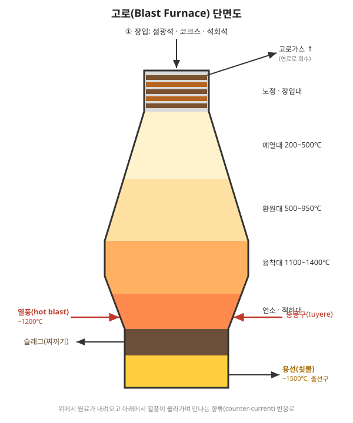

# 제선 (Ironmaking) — 고로에서 쇳물 만들기

> 제철의 첫 단계. **철광석(산화철)에서 산소를 떼어내 쇳물(용선)을 뽑는** 과정.
> 무대는 **고로(高爐, Blast Furnace = 용광로)**. 향류(위↓원료 / 아래↑열풍) 반응로다.
> 이전: [[00_overview]] (철강 전체 흐름) · 다음: 제강 `02_steelmaking.md`

---

## 핵심 개념

### 1. 목표를 한 줄로

> **Fe₂O₃(철광석) 에서 O(산소)를 떼어내 Fe(철)로 만든다 = 환원(reduction).**

산소를 떼어내려면 산소를 대신 가져갈 "짝"이 필요하다. 그 짝이 **탄소(C)와 일산화탄소(CO)** 다. 그래서 고로에는 탄소 덩어리인 **코크스**가 잔뜩 들어간다.

### 2. 3대 원료 (+ 왜 이걸 넣나)

| 원료 | 정체 | 역할 |
|------|------|------|
| **철광석** | 산화철(Fe₂O₃ 등) | 철의 원천. 산소를 떼어내야 할 대상 |
| **코크스** | 석탄을 구운 고체 탄소 | ① 연료(태워서 열) ② 환원제(산소 떼기) ③ 통기성(원료 사이 공기길 확보) |
| **석회석** | CaCO₃ | 불순물(맥석)과 결합해 **슬래그**로 분리시킴 (조연제/융제) |

> **코크스가 왜 그냥 석탄이 아닌가?** 석탄을 공기 없이 구워(건류) 불순물을 날리고 단단하게 만든 것이 코크스. 무거운 원료더미 속에서 부서지지 않고 **공기가 통하는 길**을 유지해야 하기 때문. 이 통기성이 고로 운전의 생명이다.

이 원료들은 고로에 넣기 전 전처리를 거친다:
- **소결(sintering)**: 가루 철광석을 구워 적당한 덩어리로 만듦 (통기성↑)
- **코크스 제조(coke oven)**: 석탄 → 코크스

### 3. 고로 구조와 흐름



읽는 법: **원료는 위에서 아래로 내려오고, 뜨거운 바람(열풍)은 아래에서 위로 올라간다.** 서로 반대 방향으로 흐르며(향류) 만나기 때문에, 내려오는 원료가 위로 갈수록 예열되고 아래로 갈수록 뜨거워진다.

| 위치 | 대역 | 대략 온도 | 무슨 일이 |
|------|------|-----------|-----------|
| 맨 위 | 노정·장입대 | ~200℃ | 철광석·코크스·석회석을 층층이 투입 |
| ↓ | 예열대 | 200~500℃ | 수분 증발, 원료 데워짐 |
| ↓ | 환원대 | 500~950℃ | CO가 철광석의 산소를 떼어냄 (간접환원) |
| ↓ | 융착대 | 1100~1400℃ | 철이 물러지며 녹기 시작 |
| ↓ | 연소·적하대 | ~2000℃(연소점) | 코크스가 열풍에 연소, 쇳물이 방울져 떨어짐 |
| 맨 아래 | 노상(hearth) | ~1500℃ | 쇳물(용선) 고임 + 위에 슬래그가 뜸 |

- **송풍구(tuyere)**: 노 하부에서 ~1200℃ 열풍을 불어넣어 코크스를 태운다.
- **출선구(tap hole)**: 바닥에 고인 **용선(쇳물)**을 뽑아낸다.
- **슬래그 배출**: 쇳물보다 가벼워 위에 뜬 찌꺼기를 따로 빼낸다.

### 4. 핵심 화학반응 (딱 3개만)

```
① 코크스 연소 (열 발생)
   C + O₂ → CO₂        (+ 열)

② 이산화탄소가 코크스 만나 일산화탄소로 (환원제 생성)
   CO₂ + C → 2CO

③ 일산화탄소가 철광석의 산소를 떼어냄 (핵심! 간접환원)
   Fe₂O₃ + 3CO → 2Fe + 3CO₂
```

> 외울 때 스토리로: **코크스를 태워(①) 만든 CO₂가 다시 코크스와 만나 CO가 되고(②), 그 CO가 철광석에서 산소를 훔쳐가며 철을 남긴다(③).** 산소는 결국 CO₂로 빠져나간다.

### 5. 나오는 것 3가지

| 산출물 | 정체 | 어디로 |
|--------|------|--------|
| **용선(쇳물)** | 탄소 4~4.5%의 액체 철 | → 제강으로 (탄소 낮추러) |
| **슬래그** | 불순물 찌꺼기 | → 시멘트 원료 등으로 재활용 |
| **고로가스(BFG)** | CO 등 포함 부생가스 | → 연료로 회수(발전·가열) |

> 고로에서 갓 나온 용선은 탄소가 너무 높아 **잘 깨져서 그대로는 쓸 수 없다.** 그래서 바로 다음 단계인 제강으로 넘어간다 → [[00_overview]] 참고.

---

## 왜 이게 예지보전과 직결되나 (내 도메인 연결점)

- 고로는 한 번 점화하면 **수년~십수 년 끄지 않는** 초대형 연속 설비다. 비계획 정지 = 천문학적 손실.
- 그래서 노체 온도, 송풍 압력, 진동, 냉각수 상태를 **상시 감시**하고 이상을 조기에 잡는 것이 필수다.
- 열풍을 만드는 **열풍로**, 냉각 **송풍기·팬**, 원료 이송 **컨베이어/모터** 등 회전설비의 진동 진단이 곧 내가 다루는 영역. → [[09_pdm]] · [[vibration]]

---

## 면접 예상 질문

- **Q. 제선이란 무엇이고 어떤 설비에서 이뤄지나?**
  A. 철광석을 환원해 쇳물(용선)을 뽑는 단계로, 고로(용광로)에서 이뤄진다. 위로 원료를, 아래로 열풍을 넣어 향류로 반응시킨다.

- **Q. 고로의 3대 원료와 각 역할은?**
  A. 철광석(철의 원천), 코크스(연료+환원제+통기성 확보), 석회석(불순물을 슬래그로 분리하는 융제).

- **Q. 코크스가 하는 세 가지 역할을 말해보라.**
  A. ① 연소해 열을 낸다 ② 탄소·CO로 철광석의 산소를 떼어내는 환원제다 ③ 무거운 원료더미 속에서 가스가 통할 통기성을 유지한다.

- **Q. 고로 내부의 주된 환원 반응식은?**
  A. Fe₂O₃ + 3CO → 2Fe + 3CO₂. 코크스 연소로 생긴 CO₂가 코크스와 만나 CO가 되고(CO₂+C→2CO), 이 CO가 철광석의 산소를 가져간다.

- **Q. 고로에서 나온 용선을 왜 바로 제품으로 쓰지 못하나?**
  A. 탄소가 4% 이상으로 높아 취성이 커 가공이 어렵다. 제강에서 탄소를 낮춰야 한다.

- **Q. 고로 운전에서 "통기성"이 왜 중요한가?**
  A. 열풍(환원가스)이 원료층을 고르게 통과해야 반응이 균일하게 일어난다. 통기성이 나빠지면 가스 흐름이 막혀(행잉·슬립) 조업이 불안정해진다.

---

## 더 볼 것
- 다음 단계: 제강 `02_steelmaking.md` (예정)
- 상위 지도: [[00_overview]] 철강 일관제철 전체 흐름
- 연결 도메인: [[09_pdm]] 예지보전 · [[vibration]] 진동 분석
