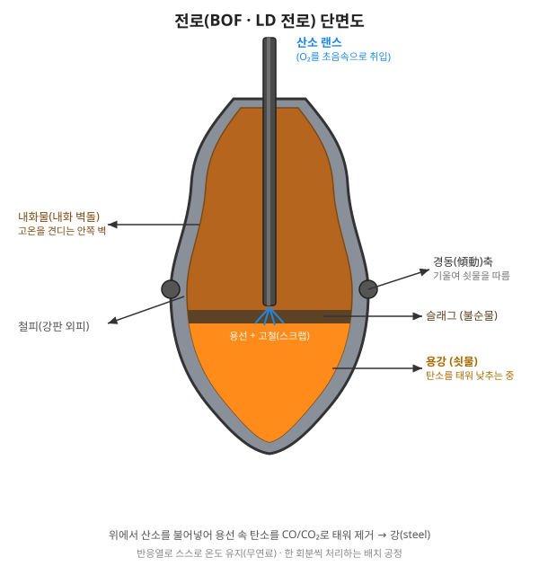

# 제강 (Steelmaking) — 쇳물을 "강"으로 만들기

> 두 번째 단계. 고로에서 나온 **용선(탄소 4~4.5%)의 탄소·불순물을 제거해** 원하는 성분의 **강(steel)**으로 만든다.
> 핵심 무대는 **전로(轉爐, Converter)**. "산소를 불어 탄소를 태운다"가 한 줄 요약.
> 이전: [[01_ironmaking]] 제선 · 다음: [[03_casting]] 연주

---

## 핵심 개념

### 1. 왜 제강이 필요한가 — 탄소를 낮춰야 한다

고로에서 나온 용선은 탄소가 **4~4.5%**로 너무 높아 단단하지만 잘 깨진다(취성). 쓸 수 있는 강(steel)은 탄소가 **0.02~2%**. 그래서 제강의 본질은:

> **용선 속 남는 탄소(C)와 불순물(P·S·Si 등)을 제거해 탄소량을 원하는 수준으로 "조준"한다.**

탄소를 어떻게 없애나? → **산소를 불어넣어 태운다.**

```
C + O₂ → CO₂ ↑     (탄소가 가스로 날아감)
2C + O₂ → 2CO ↑
```

탄소가 CO/CO₂ 가스가 되어 빠져나가면서 쇳물의 탄소 농도가 뚝 떨어진다. 이 과정을 **취련(吹鍊, blowing)**이라 한다.

### 2. 두 가지 방식: 전로 vs 전기로

| | 전로 (BOF, LD 전로) | 전기로 (EAF) |
|---|---------------------|---------------|
| 주원료 | **용선**(고로 쇳물) + 고철 약간 | **고철(스크랩)** 재활용 |
| 열원 | 없음 — **탄소 태우는 반응열**로 스스로 유지 | **전기 아크**로 녹임 |
| 특징 | 대량·고품질, 고로와 짝 | 친환경·유연, 성분 제약 |
| 대표 | 포스코·현대제철 일관제철 | 전기로 제강사 |

> 전로는 연료를 안 넣는다. 탄소·규소가 산소와 만나 타면서 나오는 **열로 1600℃대 온도를 스스로 유지**한다. 이게 전로의 신기한 점.

### 3. 전로 구조와 취련



읽는 법:
1. 용선 + 고철을 배(전로) 안에 장입한다.
2. 위에서 **산소 랜스(lance)**를 내려 초음속으로 순수 산소를 쏜다.
3. 산소가 탄소·규소·인 등과 반응해 타면서(취련) 불순물이 제거된다.
4. 불순물은 **슬래그**가 되어 위로 뜨고, 아래에는 정련된 **용강**이 남는다.
5. 전로를 **경동축(傾動軸)** 기준으로 기울여 용강을 따라낸다.

| 부위 | 역할 |
|------|------|
| 산소 랜스 | 순수 O₂를 초음속으로 취입 → 탄소 연소 |
| 내화물(내화 벽돌) | 1600℃ 쇳물을 견디는 안쪽 벽. 소모품이라 주기적 교체 |
| 철피(외피) | 전로의 강철 껍데기 |
| 경동축(트러니언) | 전로를 기울여 장입·출강하게 하는 회전축 |

### 4. 1차 정련 → 2차 정련

- **1차 정련 (전로)**: 탄소를 확 낮추는 거친 정련. "대략 맞추기".
- **2차 정련 (노외정련, Secondary Refining)**: 진공탈가스(RH), 성분 미세조정, 온도·개재물 제어. "정밀 조준".

> 자동차 외판처럼 극저탄소·고청정도가 필요한 강은 2차 정련(특히 진공탈가스)이 필수다. 여기서 최종 품질이 갈린다.

### 5. 제강의 산출물

| 산출물 | 정체 | 어디로 |
|--------|------|--------|
| **용강** | 탄소·성분을 맞춘 액체 강 | → 연주로 (굳히러) [[03_casting]] |
| **슬래그** | 인·황 등 불순물 찌꺼기 | → 시멘트·도로 골재 등 재활용 |
| **전로가스(LDG)** | CO 위주 부생가스 | → 연료로 회수 |

---

## 예지보전 연결점

- 전로는 **한 회분씩(배치)** 돌리며 기울이고 세우기를 반복 → **경동 구동장치(대형 기어·모터)의 진동·토크 감시**가 중요.
- 산소를 만드는 **산소 플랜트의 압축기**, 배가스 처리 **팬** 등 회전설비 진단이 곧 내 영역. → [[09_pdm]] · [[vibration]]
- 내화물 수명 관리(잔존 두께 추정)도 넓게 보면 설비 상태 예측 문제.

---

## 면접 예상 질문

- **Q. 제강이란 무엇인가?**
  A. 용선의 과잉 탄소와 불순물(P·S·Si 등)을 제거해 원하는 성분의 강으로 정련하는 단계다. 주로 전로에서 산소를 불어 탄소를 태운다.

- **Q. 전로에서 탄소를 어떻게 제거하나?**
  A. 산소 랜스로 순수 산소를 취입해 탄소를 CO/CO₂ 가스로 태워 날린다(취련). 규소·인 등도 산화돼 슬래그로 분리된다.

- **Q. 전로는 왜 별도 연료가 필요 없나?**
  A. 탄소·규소가 산소와 반응하며 내는 산화 반응열로 1600℃대 온도를 스스로 유지하기 때문이다(자열 반응).

- **Q. 전로법(BOF)과 전기로법(EAF)의 차이는?**
  A. 전로는 고로 용선을 주원료로 반응열로 정련해 대량·고품질에 유리하고, 전기로는 고철을 전기 아크로 녹여 재활용하며 친환경·유연 생산에 유리하다.

- **Q. 1차 정련과 2차 정련의 차이는?**
  A. 1차(전로)는 탄소를 크게 낮추는 거친 정련이고, 2차(노외정련·진공탈가스)는 성분·온도·청정도를 정밀 조정한다. 고급강일수록 2차 정련이 중요하다.

---

## 더 볼 것
- 이전: [[01_ironmaking]] 제선 · 다음: [[03_casting]] 연주
- 상위 지도: [[00_overview]] 철강 일관제철 전체 흐름
- 연결 도메인: [[09_pdm]] 예지보전
