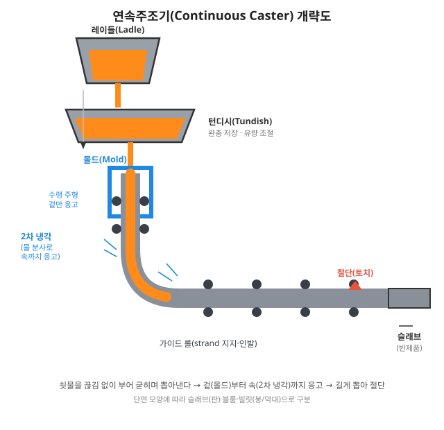

# 연주 (Continuous Casting) — 쇳물을 굳혀 반제품으로

> 세 번째 단계. 정련된 **용강을 끊김 없이 부어 굳히며 길게 뽑아** 반제품(슬래브·블룸·빌릿)으로 만든다.
> "연속주조"의 핵심은 **겉부터 속까지 순서대로 응고**시키며 계속 뽑아내는 것.
> 이전: [[02_steelmaking]] 제강 · 다음: [[04_rolling]] 압연

---

## 핵심 개념

### 1. 왜 "연속"인가 — 옛날 방식과 비교

과거엔 쇳물을 한 틀씩 부어 잉곳(ingot)으로 굳힌 뒤 다시 가열·분괴했다. 비효율적이고 불량이 많았다.
**연속주조(연주)**는 쇳물을 위에서 계속 부으면서 굳은 부분을 아래로 계속 뽑아낸다. 마치 **가래떡을 뽑듯** 끊김 없이 긴 강을 만든다.

> 장점: 수율↑(잉곳 대비 버리는 부분 감소), 품질 균일, 공정 단축. 현대 제철소는 거의 다 연주.

### 2. 연속주조기 구조와 흐름

위에서 아래로 순서대로:

| 순서 | 설비 | 하는 일 |
|------|------|---------|
| ① | **레이들(Ladle)** | 제강에서 온 용강을 담은 큰 통 |
| ② | **턴디시(Tundish)** | 완충 저장조. 유량을 일정하게 조절하고 개재물을 걸러줌 |
| ③ | **몰드(Mold)** | **수랭 구리 주형.** 바닥이 뚫려 있고, 닿는 겉면부터 응고(shell 형성) |
| ④ | **2차 냉각대** | 몰드를 빠져나온 strand에 **물을 분사**해 속까지 응고시킴 |
| ⑤ | **가이드 롤** | strand를 지지하고 아래로 뽑아내며(인발) 수직→수평으로 구부림 |
| ⑥ | **절단(토치/전단)** | 원하는 길이로 잘라 반제품 완성 |

> **핵심 감각**: 몰드에서는 **겉껍질(shell)만** 굳고 속은 아직 벌건 액체다. 그래서 몰드를 나온 뒤에도 물을 뿌려(2차 냉각) 속까지 마저 굳혀야 한다. 다 안 굳었는데 무리하면 껍질이 터져 쇳물이 새는 **브레이크아웃(breakout)** 사고가 난다.

### 3. 반제품 3형제 — 모양·용도로 구분

| 반제품 | 단면 모양 | 주 용도 |
|--------|-----------|---------|
| **슬래브(Slab)** | 넓고 납작한 판 | 열연·냉연강판, 후판 → 자동차·조선·가전 |
| **블룸(Bloom)** | 큰 사각/직사각 | 형강, 레일 등 |
| **빌릿(Billet)** | 작은 사각/봉 | 철근, 선재(와이어) 등 |

> 셋의 차이는 **단면 크기·모양**뿐, 만드는 원리는 같다. "판이면 슬래브, 굵은 막대면 블룸, 가는 막대면 빌릿" 정도로 기억.

### 4. 여기서 결정되는 품질

- **응고 속도·냉각 균일성** → 내부 균열, 중심 편석(성분 쏠림) 좌우
- **개재물 제어**(턴디시) → 청정강 품질
- **몰드 진동(오실레이션)·주조 속도** → 표면 품질

---

## 예지보전 연결점

- 연주기는 **수십~수백 개 롤**이 strand를 지지·인발하는 회전설비 덩어리 → **롤 베어링 이상, 편심, 구동 모터 진동** 감시가 곧 품질·안전 직결.
- **브레이크아웃 예측**(몰드 온도·마찰 신호 이상 감지)은 대표적인 이상 감지 문제. → [[03_anomaly]] · [[09_pdm]]
- 몰드 오실레이션 구동부, 냉각수 펌프 진동 → [[vibration]]

---

## 면접 예상 질문

- **Q. 연속주조란 무엇이고 왜 쓰나?**
  A. 용강을 끊김 없이 부어 굳히며 길게 뽑아 반제품을 만드는 공정이다. 잉곳 방식 대비 수율이 높고 품질이 균일하며 공정이 짧다.

- **Q. 몰드(주형)에서 강이 완전히 굳나?**
  A. 아니다. 몰드에서는 겉껍질만 응고하고 속은 액체다. 몰드를 나온 뒤 2차 냉각(물 분사)으로 속까지 굳힌다.

- **Q. 브레이크아웃(breakout)이 무엇인가?**
  A. 응고 껍질이 얇거나 불균일할 때 터져 내부 용강이 새어 나오는 사고다. 몰드 온도·마찰 신호로 조기 예측해 예방한다.

- **Q. 슬래브·블룸·빌릿의 차이는?**
  A. 단면 크기·모양의 차이다. 슬래브는 넓은 판(강판용), 블룸은 큰 사각(형강·레일), 빌릿은 작은 사각/봉(철근·선재)이다.

- **Q. 턴디시의 역할은?**
  A. 레이들과 몰드 사이 완충조로, 용강 유량을 일정하게 하고 비금속 개재물을 부상·분리해 청정도를 높인다.

---

## 더 볼 것
- 이전: [[02_steelmaking]] 제강 · 다음: [[04_rolling]] 압연
- 상위 지도: [[00_overview]] 철강 일관제철 전체 흐름
- 연결 도메인: [[03_anomaly]] 이상 감지 · [[09_pdm]] 예지보전
