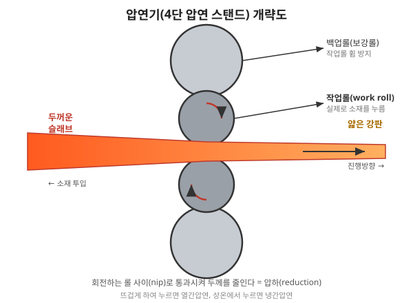

# 압연 (Rolling) — 눌러 펴서 최종 제품으로

> 마지막 단계. 반제품(슬래브 등)을 **회전하는 롤 사이로 통과시켜 얇고 길게** 만든다.
> "밀가루 반죽을 밀대로 미는 것"과 같은 원리. 두께를 줄이는 것을 **압하(壓下, reduction)**라 한다.
> 이전: [[03_casting]] 연주 · 상위: [[00_overview]] 전체 흐름

---

## 핵심 개념

### 1. 원리 한 줄

> **회전하는 두 롤 사이(nip)로 소재를 밀어 넣어, 롤 간격만큼 얇게 눌러 편다.**

두께가 줄면 부피는 보존되므로 **길이가 늘어난다.** 여러 대의 압연기(스탠드)를 연속으로 통과시켜 점점 얇게 만든다.

### 2. 압연기 구조 (4단 압연기)

| 부위 | 역할 |
|------|------|
| **작업롤(work roll)** | 소재에 직접 닿아 누르는 롤 |
| **백업롤(보강롤)** | 작업롤이 압력에 휘지 않게 뒤에서 받쳐주는 큰 롤 |
| **압하 장치** | 롤 간격을 조절해 두께를 결정 |

> 작업롤만 있으면 큰 힘에 롤이 휘어 판 두께가 가운데만 두꺼워진다. 그래서 큰 백업롤로 받쳐주는 **4단(4-high)** 구성이 흔하다.

### 3. 열간압연 vs 냉간압연 — 온도가 가른다

| | 열간압연 (Hot Rolling) | 냉간압연 (Cold Rolling) |
|---|------------------------|-------------------------|
| 온도 | 재결정온도 이상(벌겋게 달굼, ~1000℃+) | 상온 |
| 힘 | 무르니까 적은 힘으로 크게 변형 | 딱딱해서 큰 힘 필요 |
| 표면·정밀도 | 거침, 산화 스케일 생김 | **매끈·치수 정밀** |
| 결과 | 열연 코일 (두꺼운 편) | 얇고 매끈한 냉연 강판 |
| 용도 | 후판, 열연 제품, 냉연 소재 | 자동차 외판, 가전, 캔 |

흐름: **슬래브 → (가열로) → 열간압연 → 열연 코일 → (산세·냉간압연) → 냉연 강판 → (도금·도장)**

> "일단 뜨겁게 크게 편 뒤(열연), 상온에서 매끈하게 다듬는다(냉연)"로 기억. 자동차 겉판처럼 매끈해야 하는 건 냉연 + 도금까지 간다.

### 4. 압연에서 결정되는 것

- **두께 정밀도**(압하·롤 간격 제어) — 자동두께제어(AGC)
- **판 형상**(평탄도) — 롤 휨·크라운 제어
- **표면 품질** — 스케일 제거(산세), 롤 표면 상태
- **재질(기계적 성질)** — 압하율·온도·냉각으로 조직 제어

### 5. 후처리(도금·도장)

냉연 강판은 그대로 두면 녹슨다. 그래서:
- **아연도금(GI/GA)**: 아연을 입혀 부식 방지 (자동차·건자재)
- **도장·컬러강판**: 색·기능성 코팅

---

## 예지보전 연결점

- 압연기는 **초대형 롤 + 강력한 구동 모터·기어박스**의 집합체 → **베어링 결함, 기어 맞물림 이상, 롤 편심**이 진동으로 나타남. 회전설비 진동 진단의 정석 무대. → [[vibration]] · [[fft]]
- 롤 채터(chatter, 자려진동)로 인한 판 표면 결함은 **진동 스펙트럼**으로 진단.
- 냉각·유압 **펌프·팬** 상태 감시 → [[09_pdm]]

> 내 도메인(진동 분석)과 가장 직접적으로 맞닿는 공정. 면접에서 "압연 설비 진동 진단"을 엮어 말하면 강점이 된다.

---

## 면접 예상 질문

- **Q. 압연이란 무엇인가?**
  A. 회전하는 롤 사이로 소재를 통과시켜 두께를 줄이고(압하) 형상을 만드는 소성가공이다. 두께가 줄며 길이가 늘어난다.

- **Q. 열간압연과 냉간압연의 차이는?**
  A. 열간은 재결정온도 이상에서 눌러 적은 힘으로 크게 변형하나 표면이 거칠고, 냉간은 상온에서 큰 힘으로 눌러 표면이 매끈하고 치수가 정밀하다. 보통 열연 후 냉연 순으로 간다.

- **Q. 4단 압연기에서 백업롤은 왜 필요한가?**
  A. 작업롤이 큰 압연력에 휘면 판 두께가 불균일해진다. 큰 백업롤로 작업롤을 받쳐 휨을 억제해 균일한 두께를 얻는다.

- **Q. 압연 후 도금을 하는 이유는?**
  A. 냉연 강판은 부식되기 쉬워, 아연도금 등으로 방식성을 부여한다. 자동차·건자재용은 도금·도장까지 마감한다.

- **Q. 압연 설비에서 진동 진단이 왜 중요한가?**
  A. 대형 롤·기어·베어링의 결함이 진동으로 나타나고, 롤 채터는 판 표면 품질을 떨어뜨린다. 진동 스펙트럼(FFT) 분석으로 결함 주파수를 조기에 잡아 계획정비로 전환할 수 있다.

---

## 더 볼 것
- 이전: [[03_casting]] 연주 · 상위: [[00_overview]] 철강 일관제철 전체 흐름
- 연결 도메인: [[vibration]] 진동 분석 · [[fft]] FFT · [[09_pdm]] 예지보전
