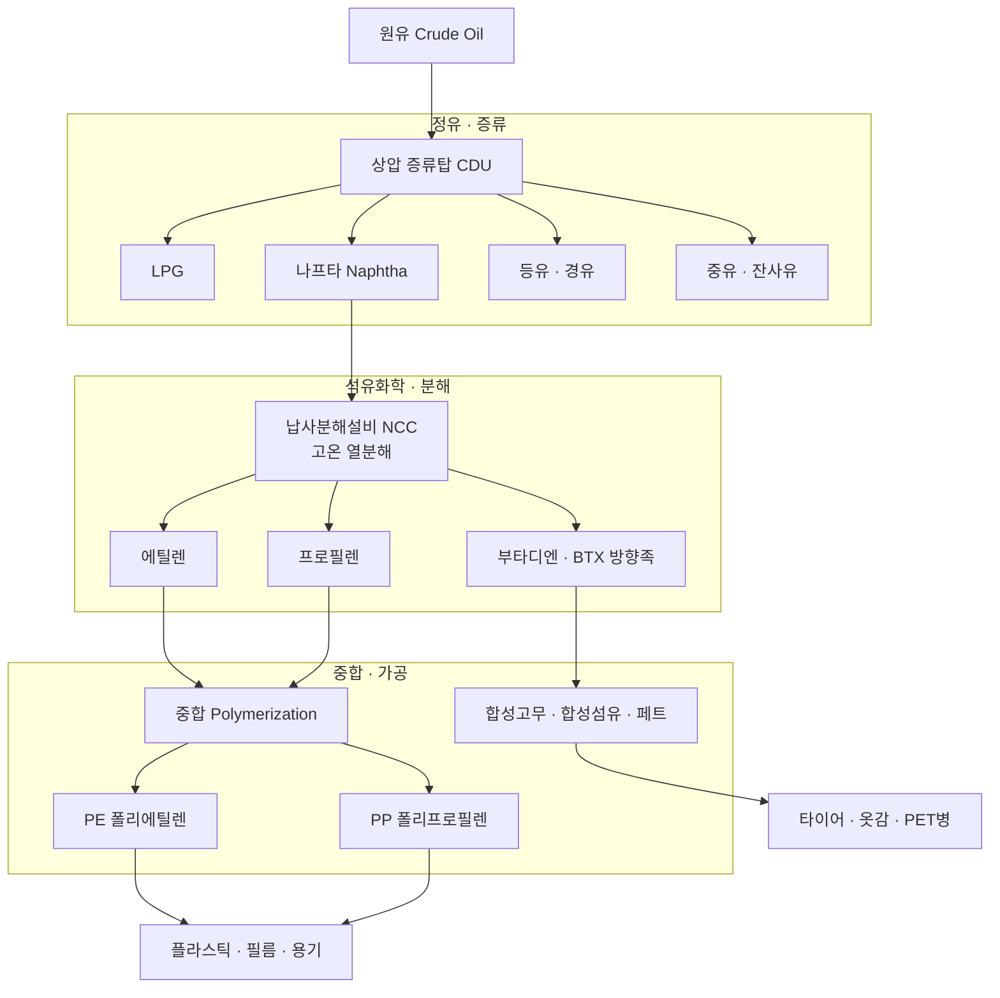

# 석유화학·정유 전체 흐름

> "원유(기름) 한 통에서 플라스틱·섬유·고무까지." 원유를 분리·변환해 우리가 쓰는 온갖 화학제품을 만드는 산업.
> 철강이 "산소를 떼는(환원)" 산업이라면, 석유화학은 **"섞인 것을 분리하고(증류), 큰 분자를 쪼개(분해), 다시 이어붙이는(중합)"** 산업이다.
> 하위: [[01_distillation]] 증류 · [[02_cracking]] 분해 · [[03_polymerization]] 중합

---

## 핵심 개념

### 1. 정유 vs 석유화학 — 뭐가 다른가

| | 정유(Refining) | 석유화학(Petrochemical) |
|---|----------------|--------------------------|
| 목적 | 원유를 **연료**로 분리 | 원유 유분을 **소재(플라스틱 등)**로 변환 |
| 대표 제품 | 휘발유·경유·항공유·LPG | 에틸렌·프로필렌 → PE·PP·합성섬유 |
| 대표 기업 | S-Oil, GS칼텍스, SK에너지 | LG화학, 롯데케미칼, 한화토탈 |
| 핵심 설비 | 증류탑(CDU) | 납사분해설비(NCC) |

> 정유가 원유를 "쓸 수 있게 나누는" 단계라면, 석유화학은 그 나눈 것(특히 나프타)을 "새로운 소재로 다시 만드는" 단계. 둘은 이어져 있다.

### 2. 큰 흐름: 원유 → 유분 → 기초유분 → 제품

### 3. 3대 핵심 공정 (이 폴더의 뼈대)

| 공정 | 하는 일 | 비유 | 문서 |
|------|---------|------|------|
| **증류(분리)** | 끓는점 차이로 원유를 유분으로 나눔 | 섞인 술에서 도수별로 뽑기 | [[01_distillation]] |
| **분해(크래킹)** | 큰 분자(나프타)를 열/촉매로 쪼개 기초유분 생성 | 긴 레고를 잘게 부수기 | [[02_cracking]] |
| **중합** | 작은 분자(단량체)를 길게 이어 폴리머로 | 작은 레고를 길게 잇기 | [[03_polymerization]] |

> **분리 → 분해 → 재조립**. 이 세 동사만 잡으면 석유화학 전체 그림이 선다.

### 4. 정유의 추가 공정 (용어만 알아두기)

- **감압증류(VDU)**: 잔사유를 진공에서 더 낮은 온도로 재증류 (탈 것 방지)
- **접촉분해(FCC)**: 무거운 유분을 촉매로 쪼개 휘발유 수율↑
- **개질(Reforming)**: 나프타의 옥탄가↑ (+ BTX 방향족 생산)
- **탈황(HDS)**: 황 제거 (환경규제 대응)

---

## 왜 "장치 산업의 대표" 인가

- 거대한 탑·반응기·배관이 **24시간 연속 운전**. 정기보수(T/A, Turn-Around) 때만 멈춘다.
- 고온·고압·가연성 → **안전(공정안전관리, PSM)**이 최우선.
- 회전설비(펌프·압축기)와 열교환기가 공정 곳곳에 → 예지보전 수요 큼. → [[09_pdm]] · [[00_overview]] (99_common)

---

## 면접 예상 질문

- **Q. 정유와 석유화학의 차이는?**
  A. 정유는 원유를 끓는점 차이로 분리해 연료(휘발유·경유 등)를 만드는 산업이고, 석유화학은 그 유분(주로 나프타)을 분해·중합해 플라스틱 등 소재를 만드는 산업이다.

- **Q. 석유화학의 3대 핵심 공정을 말해보라.**
  A. 증류(끓는점 차로 분리), 분해/크래킹(큰 분자를 기초유분으로 쪼갬), 중합(단량체를 폴리머로 이어붙임)이다.

- **Q. 나프타가 왜 중요한가?**
  A. 납사분해설비(NCC)의 원료로, 분해하면 에틸렌·프로필렌 등 석유화학의 기초 원료(기초유분)가 나오기 때문이다.

- **Q. 석유화학 공장에서 안전(PSM)이 특히 강조되는 이유는?**
  A. 고온·고압에서 가연성·유독 물질을 다루는 연속 공정이라, 누출·화재·폭발 위험이 커 공정안전관리가 필수다.

---

## 더 볼 것
- 하위: [[01_distillation]] · [[02_cracking]] · [[03_polymerization]]
- 상위: 공정 산업 큰그림 — `11_process/00_overview.md`
- 공통 설비: `11_process/99_common/` 열교환기·펌프·반응기
