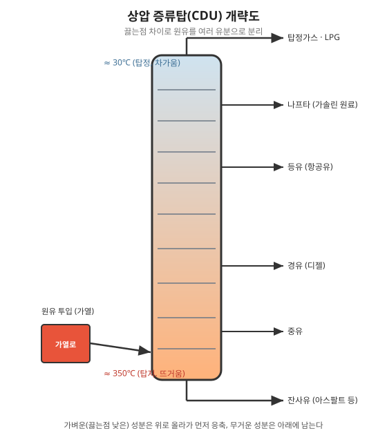

# 증류 (Distillation) — 끓는점 차이로 나누기

> 정유의 첫 단계이자 화학공정의 대표 분리법. **끓는점(비점) 차이**를 이용해 섞여 있는 원유를 여러 유분으로 나눈다.
> 무대는 **증류탑(Distillation Column)**, 정유에서는 **상압증류탑(CDU)**.
> 상위: [[00_overview]] 석유화학 전체 흐름 · 다음: [[02_cracking]] 분해

---

## 핵심 개념

### 1. 원리 한 줄

> **끓는점이 낮은 성분일수록 쉽게 증발해 위로 올라가고, 높은 성분은 아래에 남는다.**

원유를 가열하면 여러 성분이 각자의 끓는점에서 기체가 된다. 이 증기가 탑을 오르며 식으면, **자기 끓는점 높이에서 다시 액체로 응축**된다. 그래서 탑의 높이마다 다른 유분이 모인다.

### 2. 증류탑 구조와 흐름

읽는 법: 아래는 뜨겁고(≈350℃) 위로 갈수록 차갑다(≈30℃). 원유를 가열로에서 데워 탑 하부로 넣으면, 가벼운 성분부터 증발해 위로 오른다.

| 높이 | 온도 | 뽑히는 유분 | 무거움 |
|------|------|-------------|--------|
| 탑정(맨 위) | 낮음 | LPG · 가스 | 가장 가벼움 |
| ↓ | | 나프타(가솔린 원료) | |
| ↓ | | 등유(항공유) | |
| ↓ | | 경유(디젤) | |
| ↓ | | 중유 | |
| 탑저(맨 아래) | 높음 | 잔사유(아스팔트) | 가장 무거움 |

- **트레이(단, tray)**: 탑 안 계단. 증기와 액체가 각 단에서 접촉하며 분리 효율↑. (또는 충전물 packing 사용)
- **환류(reflux)**: 탑정 응축액 일부를 다시 위로 흘려보내 분리 순도를 높이는 것. 증류의 핵심 파라미터.
- **리보일러(reboiler)**: 탑저를 데워 증기를 계속 올려보냄.

### 3. 왜 "탑"이 높고 단이 많은가

한 번 끓여선 깨끗이 안 나뉜다. **증발→응축→재증발**을 여러 단(段)에 걸쳐 반복해야 순도가 올라간다. 단이 많을수록(=탑이 높을수록) 분리가 잘 된다.

> 핵심 용어: **이론단수(theoretical plates)** — 분리에 필요한 "이상적 단"의 수. 분리가 어려운 혼합물일수록 더 많은 단이 필요.

### 4. 상압증류 vs 감압증류

| | 상압증류(CDU) | 감압증류(VDU) |
|---|----------------|----------------|
| 압력 | 대기압 | 진공(저압) |
| 대상 | 원유 전체 | CDU 탑저 잔사유 |
| 이유 | — | 고온이면 타버릴 무거운 유분을 **낮은 온도에서** 끓이려고 |

> 무거운 기름은 상압에서 끓이려면 너무 뜨거워 분해(탄화)된다. 압력을 낮추면 끓는점도 낮아지므로, 진공에서 안전하게 증류한다.

---

## 예지보전 연결점

- 증류탑 자체는 회전부가 없지만, 딸린 **환류 펌프·리보일러 순환 펌프**, **가열로 유인/압입 팬**, **탑정 압축기**가 회전설비 → 진동·베어링 진단 대상. → [[02_pump-compressor]] · [[vibration]]
- **열교환기 파울링(오염)**으로 인한 성능 저하 감시도 상태 진단의 일부. → [[01_heat-exchanger]]

---

## 면접 예상 질문

- **Q. 증류의 원리는?**
  A. 성분별 끓는점 차이를 이용한다. 가열하면 끓는점 낮은 성분부터 증발해 위로 오르고, 높이별로 다시 응축돼 유분이 분리된다.

- **Q. 증류탑에서 트레이(단)가 많은 이유는?**
  A. 한 번의 증발·응축으로는 분리 순도가 낮아, 여러 단에서 증기-액체 접촉을 반복해 순도를 높이기 위해서다. 단수가 많을수록 분리가 좋아진다.

- **Q. 환류(reflux)란?**
  A. 탑정 응축액 일부를 다시 탑으로 되돌려 흘리는 것으로, 증기와 접촉시켜 분리 순도(선명도)를 높인다.

- **Q. 감압증류는 왜 하나?**
  A. 무거운 잔사유를 상압에서 끓이면 온도가 너무 높아 열분해된다. 압력을 낮춰 끓는점을 내리면 낮은 온도에서 분해 없이 증류할 수 있다.

---

## 더 볼 것
- 상위: [[00_overview]] 석유화학 전체 흐름 · 다음: [[02_cracking]] 분해
- 공통 설비: [[01_heat-exchanger]] 열교환기 · [[02_pump-compressor]] 펌프·압축기
