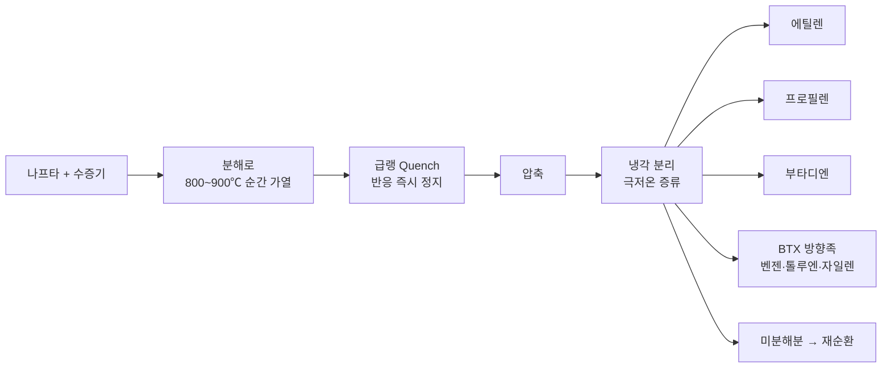

# 분해 (Cracking) — 큰 분자를 쪼개 기초유분 만들기

> 석유화학의 심장. **나프타 같은 큰 탄화수소 분자를 고온에서 쪼개(cracking)** 에틸렌·프로필렌 같은 작은 기초 원료(기초유분)를 만든다.
> 무대는 **납사분해설비(NCC, Naphtha Cracking Center)**.
> 이전: [[01_distillation]] 증류 · 다음: [[03_polymerization]] 중합

---

## 핵심 개념

### 1. 원리 한 줄

> **긴 사슬 분자를 열(또는 촉매)로 끊어 짧은 분자로 만든다.** = 크래킹(cracking, 分解)

나프타는 탄소가 여러 개 이어진 큰 분자다. 이걸 그대로는 플라스틱으로 못 만든다. 먼저 **잘게 쪼개** 반응성 좋은 작은 분자(에틸렌 C₂H₄, 프로필렌 C₃H₆ 등)로 만들어야 한다. 이 작은 것들이 석유화학의 **기초유분(building block)**이다.

### 2. 두 가지 방식: 열분해 vs 접촉분해

| | 열분해 (Thermal / Steam Cracking) | 접촉분해 (FCC) |
|---|-----------------------------------|-----------------|
| 방법 | 800~900℃ 고온 + 수증기로 순간 분해 | 촉매(catalyst)로 낮은 온도에서 분해 |
| 원료 | 나프타·에탄 (가벼운 것) | 무거운 유분(감압경유 등) |
| 주 목적 | **에틸렌·프로필렌** 생산 (석유화학) | **휘발유** 수율↑ (정유) |
| 설비 | NCC 분해로 | FCC 유닛 |

> 석유화학의 주역은 **열분해(스팀 크래킹)**. "나프타 + 수증기를 900℃ 분해로에 순식간에 통과 → 급랭(quench)"이 핵심 시퀀스.

### 3. 공정 흐름 (NCC)

- **왜 수증기를 섞나(steam)**: 원료를 희석해 원치 않는 부반응(코크스 생성)을 줄이고 분해를 돕는다. 그래서 "스팀 크래킹".
- **왜 급랭(quench)**: 800℃ 이상에서 잠깐만 반응시켜야 원하는 생성물이 나온다. 안 식히면 더 분해돼 버리므로 즉시 냉각해 반응을 "고정"한다.
- **극저온 분리**: 에틸렌·프로필렌 등은 기체라, 영하 수십~백℃로 냉각·가압해 끓는점 차로 분리한다(저온 증류).

### 4. 기초유분이 뭐가 되나

| 기초유분 | 주요 제품 |
|----------|-----------|
| 에틸렌(C₂H₄) | 폴리에틸렌(PE), PVC, 페트(PET) 원료 |
| 프로필렌(C₃H₆) | 폴리프로필렌(PP), 아크릴 |
| 부타디엔 | 합성고무(타이어) |
| BTX(벤젠·톨루엔·자일렌) | 합성섬유(나일론·폴리에스터), 페트병 |

> **에틸렌 생산능력 = 석유화학사 규모의 지표**로 흔히 쓰인다. "연산 몇만 톤 에틸렌" 같은 표현.

---

## 예지보전 연결점

- NCC의 **압축기(cracked gas compressor)**는 초대형 회전기계 — 고장 시 전 공정 정지. **진동·서징(surge) 감시**가 핵심. → [[02_pump-compressor]] · [[vibration]]
- 분해로 튜브의 **코킹(coking, 탄소 부착)**은 성능 저하 신호 → 상태 기반 정비.
- 극저온·고압 회전설비 다수 → 예지보전 수요 매우 큼. → [[09_pdm]]

---

## 면접 예상 질문

- **Q. 크래킹(분해)이란?**
  A. 큰 탄화수소 분자를 열이나 촉매로 끊어 에틸렌·프로필렌 같은 작은 기초유분으로 만드는 공정이다.

- **Q. 스팀 크래킹에서 수증기를 넣는 이유는?**
  A. 원료를 희석해 부반응(코크스 생성)을 줄이고 분해를 촉진하기 위해서다.

- **Q. 분해 후 급랭(quench)을 왜 하나?**
  A. 고온에서 잠깐만 반응시켜야 원하는 생성물을 얻는다. 즉시 냉각해 반응을 멈춰야 과분해를 막을 수 있다.

- **Q. 열분해와 접촉분해(FCC)의 차이는?**
  A. 열분해는 고온으로 나프타를 분해해 에틸렌 등 석유화학 원료를 얻고, 접촉분해는 촉매로 무거운 유분을 분해해 주로 휘발유 수율을 높인다.

- **Q. 에틸렌이 왜 석유화학의 핵심 지표인가?**
  A. 가장 기본이 되는 기초유분으로 수많은 제품의 출발 원료이며, 에틸렌 생산능력이 곧 석유화학사의 규모를 나타내기 때문이다.

---

## 더 볼 것
- 이전: [[01_distillation]] 증류 · 다음: [[03_polymerization]] 중합
- 상위: [[00_overview]] 석유화학 전체 흐름
- 공통 설비: [[02_pump-compressor]] 압축기 · [[03_reactor]] 반응기
