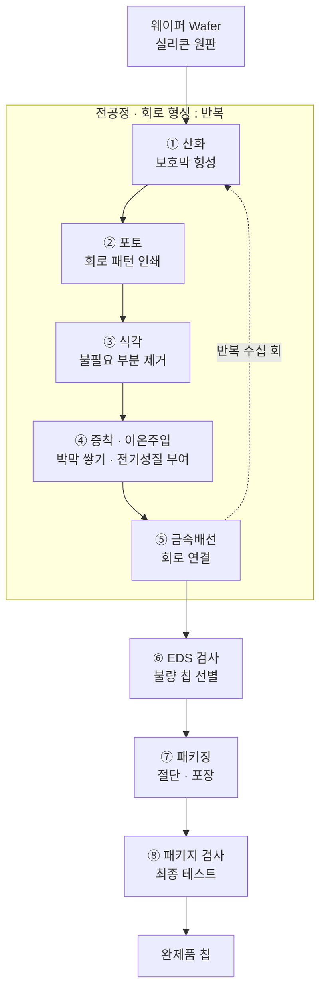

# 반도체 8대 공정 전체 흐름

> "모래(실리콘)에서 반도체 칩까지." 얇은 실리콘 웨이퍼 위에 **회로 패턴을 층층이 쌓아** 집적회로를 만든다.
> 철강·화학이 "물질을 바꾸는" 공정이라면, 반도체는 **"초미세 패턴을 정밀하게 새기고 쌓는"** 공정이다.
> 하위: [[01_photolithography]] 포토 · [[02_etch-deposition]] 식각·증착

---

## 핵심 개념

### 1. 큰 그림: 전공정 vs 후공정

| | 전공정(Fab) | 후공정(Package/Test) |
|---|-------------|----------------------|
| 하는 일 | 웨이퍼 위에 회로 형성 | 칩을 잘라 포장·검사 |
| 환경 | 초청정 클린룸 | 조립·검사 라인 |
| 핵심 | 미세화·수율 | 신뢰성·성능 검사 |

### 2. 8대 공정 흐름

> **핵심 감각**: ①~⑤가 **수십 번 반복**되며 회로가 층층이(3D) 쌓인다. 한 층이 아니라 수십 층을 정밀하게 겹치는 게 반도체의 난이도.

### 3. 8대 공정 요약

| 공정 | 하는 일 | 비유 |
|------|---------|------|
| ① 산화 | 웨이퍼 표면에 산화막(보호·절연층) 형성 | 도화지에 밑칠 |
| ② **포토** | 빛으로 회로 패턴을 감광액에 인쇄 | 사진 인화 → [[01_photolithography]] |
| ③ **식각** | 패턴대로 깎아냄 | 조각칼로 파내기 → [[02_etch-deposition]] |
| ④ 증착/이온주입 | 박막을 쌓고, 불순물 주입해 전기성질 부여 | 색칠·재료 첨가 |
| ⑤ 금속배선 | 소자들을 금속선으로 연결 | 전선 잇기 |
| ⑥ EDS | 웨이퍼 상태로 전기적 불량 검사 | 중간 검수 |
| ⑦ 패키징 | 칩 절단·포장(외부 연결·보호) | 포장 |
| ⑧ 패키지 검사 | 최종 성능·신뢰성 테스트 | 출고 검사 |

### 4. 왜 "클린룸"과 "미세화"인가

- **먼지 하나가 회로를 망친다** → 초청정 클린룸(공기 중 입자 극소).
- 회로 선폭을 줄일수록(nm 단위) 더 많은 소자를 넣어 성능↑·전력↓ → **미세화 경쟁**(EUV 노광 등).

---

## 예지보전 연결점

- Fab은 **진공펌프·냉각기·팬·컴프레서** 등 유틸리티 회전설비 덩어리 → 진동·상태 진단 수요. → [[02_pump-compressor]] · [[vibration]]
- 공정 장비의 미세 이상이 **수율 저하**로 직결 → 센서 데이터 기반 이상 감지(APC/FDC). → [[03_anomaly]] · [[09_pdm]]

---

## 면접 예상 질문

- **Q. 반도체 전공정과 후공정의 차이는?**
  A. 전공정은 웨이퍼 위에 회로를 형성하는 단계(산화·포토·식각·증착·배선)이고, 후공정은 완성된 칩을 절단·포장하고 검사하는 단계다.

- **Q. 8대 공정에서 ①~⑤가 반복되는 이유는?**
  A. 회로가 한 층이 아니라 수십 층으로 3D로 쌓이기 때문에, 각 층마다 산화·포토·식각·증착·배선을 반복해야 한다.

- **Q. 포토공정이 왜 핵심인가?**
  A. 회로 패턴을 웨이퍼에 옮기는 단계로, 선폭(미세화)을 결정하며 이후 식각·증착의 기준이 되기 때문이다.

- **Q. 클린룸이 필요한 이유는?**
  A. 나노 단위 회로에서는 미세 먼지 하나도 결함이 되어 수율을 떨어뜨리므로 공기 중 입자를 극도로 통제한다.

---

## 더 볼 것
- 하위: [[01_photolithography]] 포토 · [[02_etch-deposition]] 식각·증착
- 상위: 공정 산업 큰그림 — `11_process/00_overview.md`
- 공통 설비: [[02_pump-compressor]] 회전설비
