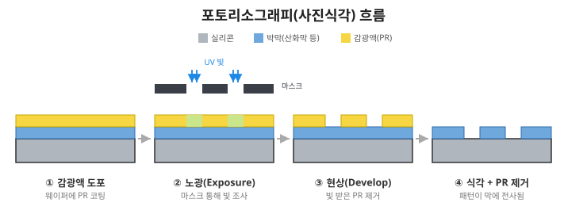

# 포토리소그래피 (Photolithography) — 빛으로 회로 새기기

> 반도체 8대 공정의 심장. **빛(UV)을 이용해 마스크의 회로 패턴을 웨이퍼 위 감광액에 옮긴다.** "사진 인화"와 같은 원리라 사진식각이라고도 한다.
> 이 공정이 **선폭(미세화)을 결정**하고, 이후 식각·증착의 밑그림이 된다.
> 상위: [[00_overview]] 반도체 8대 공정 · 다음: [[02_etch-deposition]] 식각·증착

---

## 핵심 개념

### 1. 원리 한 줄

> **회로 도면(마스크)에 빛을 통과시켜, 웨이퍼에 바른 감광액(PR)에 패턴을 인쇄한다.**

빛을 받은 부분과 안 받은 부분의 **화학적 성질 차이**를 이용해, 현상 후 원하는 모양만 남긴다.

### 2. 흐름 (도포 → 노광 → 현상 → 식각)

| 단계 | 하는 일 |
|------|---------|
| ① **감광액 도포** | 웨이퍼에 PR(Photo Resist)을 얇고 고르게 코팅 (스핀 코팅) |
| ② **노광(Exposure)** | 마스크를 통해 UV를 조사 → 빛 받은 PR의 성질 변화 |
| ③ **현상(Develop)** | 현상액으로 특정 PR을 녹여 제거 → PR에 패턴 형성 |
| ④ **식각/후속** | 드러난 부분을 깎거나(식각) 재료를 넣음 → 패턴 전사 후 PR 제거 |

### 3. 양성 vs 음성 감광액

| | 양성(Positive) PR | 음성(Negative) PR |
|---|-------------------|-------------------|
| 빛 받은 부분 | 현상 시 **녹아 제거** | 현상 시 **남음** |
| 해상도 | 높음(주로 사용) | 낮음 |

> 위 그림은 양성 PR: 빛 받은(노광된) 부분이 현상에서 제거된다.

### 4. 미세화의 핵심 — 왜 EUV인가

빛으로 그릴 수 있는 최소 선폭은 **빛의 파장**에 좌우된다. 파장이 짧을수록 더 미세한 패턴이 가능.

| 광원 | 파장 | 용도 |
|------|------|------|
| ArF (불화아르곤) | 193 nm | 기존 미세공정 |
| **EUV (극자외선)** | 13.5 nm | 최첨단 미세공정 |

> EUV는 파장이 매우 짧아 수 nm급 회로를 그린다. 장비가 극도로 비싸고 복잡해(진공·반사광학) 소수 업체만 보유 — 반도체 경쟁력의 상징.

### 5. 여기서 결정되는 것

- **해상도**(얼마나 미세하게) — 광원 파장·렌즈(NA)
- **오버레이(정렬 정밀도)** — 층과 층을 얼마나 정확히 겹치나
- **결함** — 먼지·PR 불균일이 곧 불량 → 클린룸·수율 직결

---

## 예지보전 연결점

- 노광 장비의 **스테이지 구동·진공펌프**, 도포 장비의 **스핀 모터** 등 정밀 회전·구동부 상태 감시. → [[02_pump-compressor]] · [[vibration]]
- 공정 파라미터 미세 변동이 수율에 직결 → 센서 기반 이상 감지(FDC). → [[03_anomaly]]

---

## 면접 예상 질문

- **Q. 포토리소그래피란?**
  A. 마스크의 회로 패턴을 빛으로 웨이퍼의 감광액에 옮기는 공정이다. 도포→노광→현상→식각 순으로 진행되며 선폭을 결정한다.

- **Q. 양성 감광액과 음성 감광액의 차이는?**
  A. 양성은 빛 받은 부분이 현상 시 제거되고, 음성은 빛 받은 부분이 남는다. 해상도가 높아 양성이 주로 쓰인다.

- **Q. EUV 노광이 중요한 이유는?**
  A. 파장이 13.5nm로 매우 짧아 수 nm급 초미세 패턴을 그릴 수 있기 때문이다. 미세화·집적도 향상의 핵심 기술이다.

- **Q. 오버레이(overlay)란?**
  A. 여러 층의 패턴을 겹칠 때 층 간 정렬 정밀도를 말한다. 회로가 수십 층 쌓이므로 매우 중요하다.

---

## 더 볼 것
- 상위: [[00_overview]] 반도체 8대 공정 · 다음: [[02_etch-deposition]] 식각·증착
