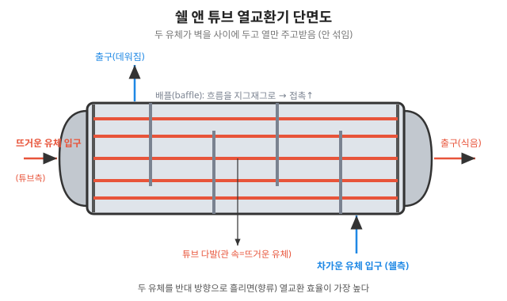

# 열교환기 (Heat Exchanger) — 열만 주고받기

> 두 유체를 **섞지 않고** 벽(관)을 사이에 두고 **열만 이동**시키는 설비. 공정 어디에나 있다(폐열 회수, 냉각, 예열).
> 대표 형식은 **쉘 앤 튜브(Shell & Tube)**.
> 상위: [[00_overview]] 공통 단위공정

---

## 핵심 개념

### 1. 원리 한 줄

> **뜨거운 유체와 차가운 유체를 얇은 금속벽을 사이에 두고 흘려, 열만 전달한다.** 두 유체는 절대 섞이지 않는다.

목적은 두 가지:
- **회수**: 버려질 뜨거운 유체의 열을 다른 유체 데우는 데 재사용 → 에너지 절감
- **온도 맞춤**: 반응 전 예열, 반응 후 냉각

### 2. 쉘 앤 튜브 구조

| 부위 | 역할 |
|------|------|
| **튜브(관)** | 한쪽 유체가 관 **속**으로 흐름 (튜브측) |
| **쉘(몸통)** | 다른 유체가 관 **밖**으로 흐름 (쉘측) |
| **관판(tube sheet)** | 튜브를 고정하고 두 유체를 분리 |
| **배플(baffle)** | 쉘측 유체를 지그재그로 흐르게 해 접촉·난류↑ → 열전달↑ |

### 3. 향류 vs 병류 — 흐름 방향이 효율을 가른다

| | 향류(counter-current) | 병류(co-current) |
|---|------------------------|-------------------|
| 방향 | 두 유체 **반대** 방향 | 두 유체 **같은** 방향 |
| 효율 | **높음** (온도차 고르게 유지) | 낮음 |
| 채택 | 대부분 향류 | 특수 목적 |

> 향류가 좋은 이유: 출구 쪽에서도 두 유체 사이 온도차가 남아 있어 끝까지 열이 잘 넘어간다. 병류는 금세 온도가 비슷해져 후반부에 열이 잘 안 넘어간다.

### 4. 성능을 지배하는 것

열전달량 **Q = U · A · ΔT**
- **U**: 총괄열전달계수 (재질·유속·오염 상태)
- **A**: 전열 면적 (튜브 수·길이)
- **ΔT**: 두 유체 온도차 (향류로 크게 유지)

### 5. 파울링(Fouling) — 열교환기의 숙적

- **파울링**: 튜브 안팎에 스케일·슬러지·이물질이 끼어 열전달을 방해하는 현상.
- 파울링이 쌓이면 U가 떨어져 **같은 조건에서도 열이 덜 넘어간다** → 출구온도로 성능 저하가 드러남.
- 주기적 세정·정비 필요. **성능 데이터 추이로 세정 시점을 예측**하는 것이 상태기반정비의 예.

---

## 예지보전 연결점

- 열교환기 자체는 회전부가 없지만, **성능 저하(파울링) 감시**는 대표적 상태 진단 문제 — 입출구 온도·압력강하 추이로 열화 추정. → [[03_anomaly]]
- 딸린 순환 **펌프**, 공랭식이면 **팬** 진동 진단. → [[02_pump-compressor]] · [[vibration]]

---

## 면접 예상 질문

- **Q. 열교환기의 원리는?**
  A. 두 유체를 금속벽(관)을 사이에 두고 흘려, 섞지 않고 열만 전달한다. 폐열 회수나 온도 조절에 쓴다.

- **Q. 향류와 병류 중 왜 향류가 효율적인가?**
  A. 향류는 유체 흐름 전 구간에서 온도차가 고르게 유지돼 끝까지 열전달이 잘 일어난다. 병류는 곧 온도가 비슷해져 후반 열전달이 떨어진다.

- **Q. 배플의 역할은?**
  A. 쉘측 유체를 지그재그로 흐르게 해 유속·난류와 튜브 접촉을 늘려 열전달을 향상시킨다.

- **Q. 파울링이란 무엇이고 어떻게 감지하나?**
  A. 전열면에 이물질이 쌓여 열전달을 방해하는 현상이다. 총괄열전달계수 저하로 나타나며, 출구온도·압력강하 추이를 보면 알 수 있어 세정 시점 예측에 활용한다.

---

## 더 볼 것
- 상위: [[00_overview]] 공통 단위공정
- 관련: [[02_pump-compressor]] 회전설비 · [[01_distillation]] 증류(리보일러/콘덴서)
