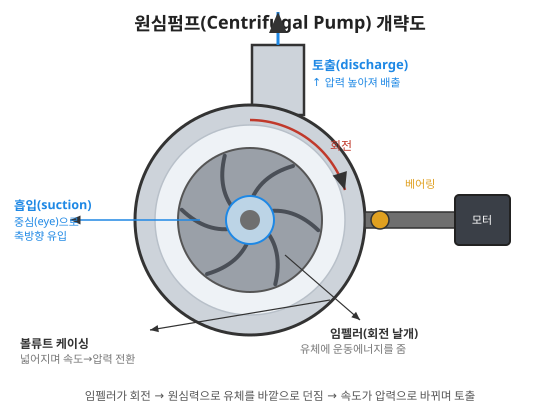

# 펌프 · 압축기 (회전설비) — 유체를 밀어 보내기

> 공정의 "심장". 액체를 밀면 **펌프**, 기체를 밀면 **압축기/팬**. 어느 장치 산업에나 수백~수천 대가 돌아간다.
> **★ 내 도메인(진동 분석·예지보전)과 가장 직접 맞닿는 설비.** 면접에서 강점으로 엮기 좋다.
> 상위: [[00_overview]] 공통 단위공정 · 연결: [[vibration]] · [[fft]] · [[09_pdm]]

---

## 핵심 개념

### 1. 무엇을 미느냐로 나뉜다

| 유체 | 설비 | 압력 상승 |
|------|------|-----------|
| 액체 | **펌프(Pump)** | 큼 |
| 기체 | **압축기(Compressor)** | 큼 |
| 기체 | **송풍기·팬(Fan/Blower)** | 작음 (주로 유량) |

### 2. 원심식 vs 용적식 — 미는 방식의 두 갈래

| | 원심식(Centrifugal) | 용적식(Positive Displacement) |
|---|----------------------|-------------------------------|
| 방식 | 임펠러 회전 → 원심력으로 밀어냄 | 공간을 줄여 밀어냄(피스톤·기어·스크루) |
| 유량/압력 | 대유량, 연속·맥동 적음 | 정량 토출, 고압 유리 |
| 예 | 원심펌프, 원심압축기 | 왕복압축기, 기어펌프, 스크루 |

> 대형 연속공정의 주력은 **원심식**. 대유량을 부드럽게 보낸다.

### 3. 원심펌프 구조

작동 순서:
1. 유체가 **흡입구(eye)**로 축방향 유입.
2. 회전하는 **임펠러**가 원심력으로 유체를 바깥으로 던진다 → **운동에너지(속도)** 부여.
3. **볼류트 케이싱**(나선형)이 넓어지며 속도를 **압력**으로 바꾼다.
4. **토출구**로 높은 압력으로 배출.

| 부위 | 역할 |
|------|------|
| 임펠러 | 회전하며 유체에 에너지를 줌 (핵심 회전체) |
| 볼류트 케이싱 | 속도 → 압력 전환 |
| 축(shaft) + 모터 | 임펠러를 돌림 |
| **베어링** | 축을 지지 (진동 진단의 최전선) |
| 실(seal) | 누설 방지 |

### 4. 대표 이상현상 (면접 단골)

| 현상 | 무엇인가 | 신호 |
|------|----------|------|
| **캐비테이션(공동현상)** | 흡입 압력 부족 → 액체가 국부 기화·기포 붕괴 → 임펠러 침식·소음·진동 | 소음, 특유 진동, 성능↓ |
| **서징(surge)** | 압축기에서 유량 부족 시 흐름이 역류·맥동 | 큰 진동·소음, 위험 |
| **불평형(unbalance)** | 임펠러 질량 편심 | 1× 회전주파수 진동↑ |
| **정렬불량(misalignment)** | 축-모터 축심 어긋남 | 2× 성분 진동↑ |
| **베어링 결함** | 구름/미끄럼 베어링 손상 | 고주파·특정 결함주파수 |

### 5. 왜 진동으로 진단하나 (내 도메인 핵심)

회전설비의 고장은 **회전주파수와 그 배수(1×, 2×, …)나 베어링 결함주파수**로 진동 스펙트럼에 나타난다.
- **불평형** → 1× 우세
- **정렬불량** → 2× 우세
- **베어링 결함** → BPFO/BPFI 등 고유 주파수 + 고주파 대역
- **풀림(looseness)** → 다수 고조파

→ 진동을 FFT로 분석하면 "어디가 어떻게 고장나는 중인지"를 분해 능력이 생긴다. [[fft]] · [[feature_extraction]] · [[vibration]]

---

## 예지보전 연결점 (이 문서가 곧 내 전공)

- 가속도/속도 센서로 진동을 상시 측정 → FFT·특징추출 → 이상 조기 감지 → 계획정비 전환.
- **캐비테이션·서징·불평형·정렬불량·베어링**이 곧 예지보전이 잡아야 할 주요 타깃.
- 이 설비 지식 + 진동 분석 역량의 결합이 장치 산업 지원 시 **차별화 포인트**. → [[09_pdm]] · [[03_anomaly]]

---

## 면접 예상 질문

- **Q. 원심펌프의 작동 원리는?**
  A. 회전하는 임펠러가 원심력으로 유체를 바깥으로 밀어 속도(운동에너지)를 주고, 볼류트 케이싱에서 그 속도를 압력으로 바꿔 토출한다.

- **Q. 캐비테이션이란 무엇이고 왜 문제인가?**
  A. 흡입측 압력이 유체 증기압 아래로 떨어져 국부 기화·기포 붕괴가 일어나는 현상이다. 임펠러 침식, 소음, 진동, 성능 저하를 일으킨다. 흡입 조건(NPSH) 확보로 예방한다.

- **Q. 압축기의 서징(surge)은?**
  A. 유량이 일정 이하로 떨어질 때 흐름이 불안정해져 역류·맥동이 반복되는 현상으로, 큰 진동과 설비 손상을 유발한다. 안티서지 제어로 방지한다.

- **Q. 진동 분석으로 불평형과 정렬불량을 어떻게 구분하나?**
  A. 불평형은 회전주파수의 1× 성분이 우세하고, 정렬불량은 2× 성분이 두드러진다. FFT 스펙트럼의 주파수 성분 비교로 구분한다.

- **Q. 원심식과 용적식 펌프의 차이는?**
  A. 원심식은 임펠러 회전으로 대유량을 연속 토출하고, 용적식은 공간 변화로 정량을 밀어내 고압에 유리하다.

---

## 더 볼 것
- 상위: [[00_overview]] 공통 단위공정
- ★ 내 도메인: [[vibration]] 진동 · [[fft]] FFT · [[feature_extraction]] 특징추출 · [[09_pdm]] 예지보전
- 관련: [[03_anomaly]] 이상 감지
